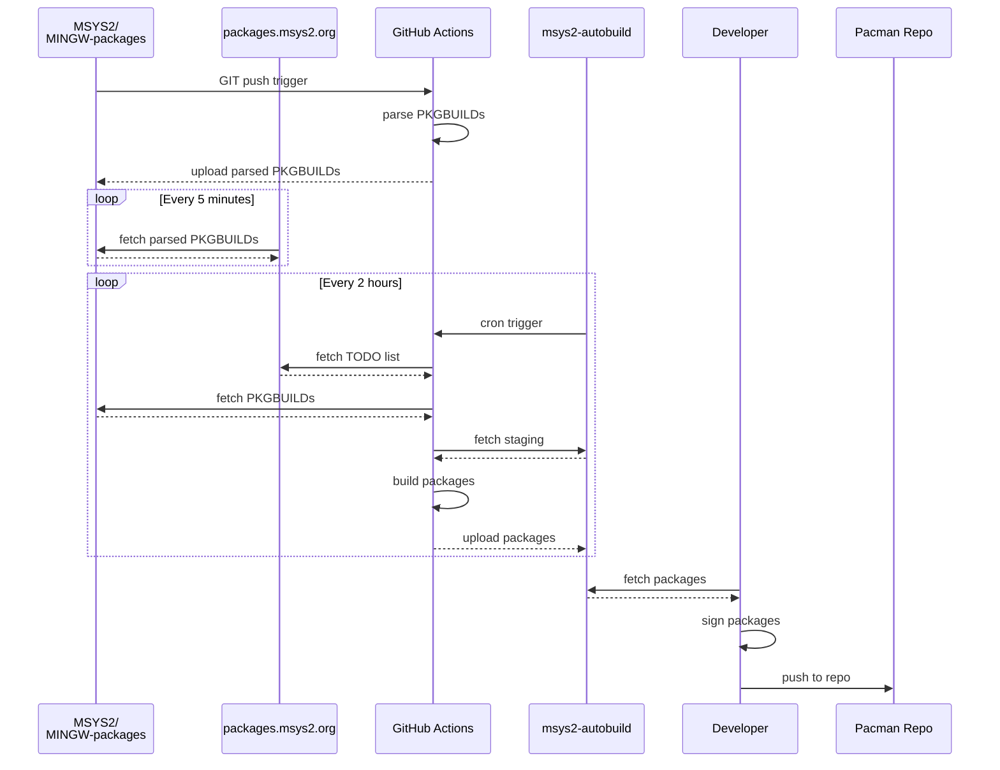
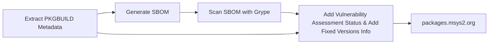

# Codebase Digest: msys2.github.io

- Files analyzed: 88
- Total lines: 6483
- Total size: 326.7 KB
- Git branch: `main`
- Git HEAD commit: `7c9dc8ba (mention mingw64 less in guides (#451))`
- Digest mode: `AST-Smart Outline`

## Directory Structure

```text
msys2.github.io/
├── LICENSE.md (32 lines, 1.6 KB, ~441 tokens)
├── README.md (47 lines, 2.7 KB, ~798 tokens)
├── fonts/
│   ├── README.md (2 lines, 26 B, ~7 tokens)
│   ├── build.sh (1 lines, 35 B, ~11 tokens)
│   └── package.json (13 lines, 386 B, ~146 tokens)
├── licenses/
│   ├── BSD-3-Clause.txt (28 lines, 1.5 KB, ~342 tokens)
│   ├── CC-BY-SA-4.0.txt (427 lines, 19.7 KB, ~4.6k tokens)
│   └── CC0-1.0.txt (121 lines, 6.9 KB, ~1.6k tokens)
├── linkcheck.sh (1 lines, 34 B, ~10 tokens)
├── lychee.toml (7 lines, 102 B, ~29 tokens)
├── mkdocs.yml (188 lines, 5.5 KB, ~1.5k tokens)
├── news2rss.py (13 lines, 389 B, ~110 tokens)
├── news2rss.xsl (63 lines, 2.8 KB, ~739 tokens)
├── overrides/
│   ├── fonts/
│   │   ├── chivo/
│   │   │   ├── latin-400.css (1 lines, 34 B, ~10 tokens)
│   │   │   ├── latin-700.css (1 lines, 34 B, ~10 tokens)
│   │   │   └── latin-900.css (1 lines, 34 B, ~10 tokens)
│   │   ├── roboto/
│   │   │   ├── latin-300.css (1 lines, 34 B, ~10 tokens)
│   │   │   ├── latin-400-italic.css (1 lines, 34 B, ~10 tokens)
│   │   │   ├── latin-400.css (1 lines, 34 B, ~10 tokens)
│   │   │   └── latin-700.css (1 lines, 34 B, ~10 tokens)
│   │   └── roboto-mono/
│   │       └── latin-400.css (1 lines, 34 B, ~10 tokens)
│   └── main.html (1 lines, 35 B, ~11 tokens)
├── pyproject.toml (24 lines, 475 B, ~153 tokens)
└── web/
    ├── codeofconduct.md (144 lines, 5.9 KB, ~1.4k tokens)
    ├── contact.md (22 lines, 1.5 KB, ~408 tokens)
    ├── dev/
    │   ├── accounts.md (20 lines, 1.5 KB, ~408 tokens)
    │   ├── build-process.md (64 lines, 2.1 KB, ~541 tokens)
    │   ├── code-signing.md (92 lines, 4.3 KB, ~1.1k tokens)
    │   ├── keyring.md (32 lines, 3.1 KB, ~948 tokens)
    │   ├── mirrors.md (139 lines, 7.4 KB, ~2.3k tokens)
    │   ├── new-package.md (108 lines, 5.2 KB, ~1.4k tokens)
    │   ├── package-guidelines.md (68 lines, 3.5 KB, ~899 tokens)
    │   ├── package-licensing.md (79 lines, 3.6 KB, ~983 tokens)
    │   ├── pkgbuild.md (59 lines, 5.0 KB, ~1.4k tokens)
    │   ├── python.md (20 lines, 920 B, ~247 tokens)
    │   ├── update-package.md (41 lines, 2.1 KB, ~543 tokens)
    │   └── vulnerabilities.md (68 lines, 2.7 KB, ~769 tokens)
    ├── docs/
    │   ├── arm64.md (21 lines, 992 B, ~254 tokens)
    │   ├── autotools.md (42 lines, 2.0 KB, ~520 tokens)
    │   ├── c.md (49 lines, 1.9 KB, ~512 tokens)
    │   ├── ci.md (167 lines, 6.3 KB, ~1.8k tokens)
    │   ├── cmake.md (49 lines, 1.6 KB, ~432 tokens)
    │   ├── configuration.md (25 lines, 1.3 KB, ~315 tokens)
    │   ├── cpp.md (5 lines, 329 B, ~82 tokens)
    │   ├── environments.md (114 lines, 5.9 KB, ~1.7k tokens)
    │   ├── faq.md (98 lines, 6.0 KB, ~1.5k tokens)
    │   ├── filesystem-paths.md (123 lines, 4.8 KB, ~1.3k tokens)
    │   ├── git.md (25 lines, 1.3 KB, ~352 tokens)
    │   ├── ides-editors.md (100 lines, 3.0 KB, ~840 tokens)
    │   ├── installer.md (147 lines, 6.4 KB, ~1.7k tokens)
    │   ├── jit-debugging.md (42 lines, 2.1 KB, ~597 tokens)
    │   ├── mirrors.md (38 lines, 1.6 KB, ~420 tokens)
    │   ├── package-management-faq.md (5 lines, 621 B, ~153 tokens)
    │   ├── package-management-tips.md (71 lines, 2.2 KB, ~642 tokens)
    │   ├── package-management.md (119 lines, 6.0 KB, ~1.6k tokens)
    │   ├── package-naming.md (111 lines, 4.0 KB, ~1.1k tokens)
    │   ├── pacman.md (14 lines, 732 B, ~186 tokens)
    │   ├── pkgconfig.md (102 lines, 4.3 KB, ~1.2k tokens)
    │   ├── python.md (36 lines, 2.7 KB, ~696 tokens)
    │   ├── repos-mirrors.md (33 lines, 839 B, ~230 tokens)
    │   ├── symlinks.md (110 lines, 5.6 KB, ~1.4k tokens)
    │   ├── terminals.md (132 lines, 4.8 KB, ~1.4k tokens)
    │   ├── updating.md (101 lines, 4.2 KB, ~1.1k tokens)
    │   ├── what-is-msys2.md (59 lines, 2.6 KB, ~673 tokens)
    │   ├── who-is-using-msys2.md (36 lines, 4.5 KB, ~1.3k tokens)
    │   └── windows_support.md (64 lines, 4.1 KB, ~1.1k tokens)
    ├── get-involved.md (23 lines, 772 B, ~206 tokens)
    ├── index.md (147 lines, 6.9 KB, ~2.0k tokens)
    ├── license.md (9 lines, 838 B, ~215 tokens)
    ├── news.md (1171 lines, 59.0 KB, ~15.7k tokens)
    ├── privacy.md (29 lines, 1.5 KB, ~379 tokens)
    ├── stylesheets/
    │   ├── extra.css (1 lines, 36 B, ~11 tokens)
    │   └── fonts.css (1 lines, 34 B, ~10 tokens)
    └── wiki/
        ├── Creating-Packages.md (226 lines, 15.2 KB, ~4.0k tokens)
        ├── Devtopics.md (153 lines, 9.7 KB, ~2.6k tokens)
        ├── Distributing.md (19 lines, 1.3 KB, ~364 tokens)
        ├── GDB-qtcreator.md (15 lines, 845 B, ~219 tokens)
        ├── History.md (46 lines, 2.7 KB, ~655 tokens)
        ├── Home.md (37 lines, 2.5 KB, ~689 tokens)
        ├── How-does-MSYS2-differ-from-Cygwin.md (48 lines, 3.7 KB, ~932 tokens)
        ├── Launchers.md (47 lines, 4.0 KB, ~1.1k tokens)
        ├── MSYS2-introduction.md (54 lines, 5.4 KB, ~1.4k tokens)
        ├── MSYS2-reinstallation.md (55 lines, 2.1 KB, ~600 tokens)
        ├── Porting.md (217 lines, 15.0 KB, ~4.1k tokens)
        ├── Setting-up-SSHd.md (107 lines, 3.7 KB, ~1.1k tokens)
        ├── Signing-packages.md (51 lines, 2.3 KB, ~670 tokens)
        ├── Sudo.md (21 lines, 1.8 KB, ~469 tokens)
        └── Terminals.md (36 lines, 3.7 KB, ~942 tokens)
```

## Source Files

================================================
FILE: README.md
================================================
<p align="center">
  <a title="msys2.github.io" href="https://msys2.github.io"></a><!--
  -->
  <a title="Join the chat on Matrix" href="https://matrix.to/#/#msys2_msys2:gitter.im"></a><!--
  -->
  <a title="GitHub Actions" href="https://github.com/msys2/msys2.github.io/actions?query=workflow%3Agithub%20pages"></a><!--
  -->
  <a title="Follow msys2org on Mastodon" href="https://fosstodon.org/@msys2org"></a><!--
  -->
  <a title="Join the community on Discord" href="https://discord.com/invite/jPQdRdDcT9"></a><!--
  -->
</p>

# MSYS2 Website

## Overview

This website is written in Markdown and gets built to a static website using
[Zensical](https://zensical.org/). Any new commits to the
`main` branch will auto deploy to [GitHub pages](https://pages.github.com) using
[a GitHub action](https://github.com/actions/deploy-pages). The resulting
website is reachable under https://msys2.github.io and https://www.msys2.org.
Changes to the `main` branch usually take a minute or two until they are live.

## Development

For small changes:

* Just use the online editor on GitHub and use the Markdown preview to inspect your changes
* Open a PR with your changes in case you don't have commit rights
* **Note:** The Markdown dialect and extensions understood by Zensical and GitHub are
  slightly different, so double check that the deployed website matches what you
  expected
* **Note:** Every page on the website has a small "edit" icon in the top right corner which leads you straight to the online editor for that page

For larger changes:

* `uv run zensical serve --config-file mkdocs.yml`
* Access http://127.0.0.1:8000 - any changes to the sources should be
  immediately visible in your browser
* Open a PR with your changes or just push them if you have commit rights

### Link Checker

Run `./linkcheck.sh` to check for broken links. This script uses
[lychee](https://github.com/lycheeverse/lychee) and requires Docker to be
installed.


================================================
FILE: fonts/README.md
================================================
npm install
npm run build


================================================
FILE: fonts/package.json
================================================
// [OUTLINE - 12 symbols, 16 lines]
// L2: "name": "msys2-fonts"
// L3: "version": "1.0.0"
// L4: "description": ""
// L5: "main": "index.js"
// L6-L8: "scripts":
// L7: "build": "./build.sh"
// L9: "author": ""
// L10: "license": "MIT"
// L11-L15: "dependencies":
// L12: "@fontsource/chivo": "^4.5.1"
// L13: "@fontsource/roboto": "^4.5.2"
// L14: "@fontsource/roboto-mono": "^4.5.1"


================================================
FILE: pyproject.toml
================================================
[project]
name = "msys2.org"
version = "1.0"
description = ""
authors = [{ name = "Christoph Reiter", email = "reiter.christoph@gmail.com" }]
requires-python = ">=3.10,<4.0"

[dependency-groups]
dev = [
    "zensical>=0.0.58,<0.1",
    "beautifulsoup4>=4.13.4,<5",
]

[tool.uv]
package = false
exclude-newer = "7 days"
exclude-newer-package = { zensical = false }

[tool.poetry]
package-mode = false

[build-system]
requires = ["hatchling"]
build-backend = "hatchling.build"


================================================
FILE: LICENSE.md
================================================
For historical reasons the license of the website content isn't very clear. The
content under `web/wiki` was initially maintained in a Sourceforge wiki, then in
a GitHub wiki and then it was imported into this repo, and doesn't have a
license.

Any content added after 2023-03-03 is licensed under the following terms:

* The website content is licensed under [CC-BY-SA-4.0](./licenses/CC-BY-SA-4.0.txt)
* All code samples are licensed under [CC0-1.0](./licenses/CC0-1.0.txt)
* Everything else, like code/configuration/templates/stylesheets and similar, that are used for building and maintaining the website is licensed under [BSD-3-Clause](./licenses/BSD-3-Clause.txt)

The same is true for all content by the following authors independent of when it
was added:

* Christoph Reiter (<https://github.com/lazka>)
* David Macek (<https://github.com/elieux>)

This of course does not apply to any content that is explicitly licensed under
different licenses.

----

Files/content included from other sources:

* `overrides/fonts/*`: auto generated from npm packages, see fonts/package.json for details
* `web/ray.jpg`: taken from https://www.gofundme.com/f/help-Ray-fund-a-hospice-bedroom
* `web/donate/github*.png`: taken from https://github.com/logos
* `web/donate/opencollective.png`: taken from https://docs.opencollective.com/help/collectives/widgets
* `web/sponsors/jsdelivr*.svg`: taken from  https://github.com/jsdelivr/jsdelivr-media
* `web/codeofconduct.md`: taken from https://www.contributor-covenant.org/version/2/0/code_of_conduct

See the respective sources for license information.


================================================
FILE: fonts/build.sh
================================================
// [OUTLINE - 0 symbols, 21 lines]


================================================
FILE: licenses/BSD-3-Clause.txt
================================================
Copyright (c) 2023, MSYS2 developers

All rights reserved.

Redistribution and use in source and binary forms, with or without modification,
are permitted provided that the following conditions are met:

* Redistributions of source code must retain the above copyright notice, this
  list of conditions and the following disclaimer.

* Redistributions in binary form must reproduce the above copyright notice, this
  list of conditions and the following disclaimer in the documentation and/or
  other materials provided with the distribution.

* Neither the name of the MSYS2 project nor the names of its
  contributors may be used to endorse or promote products derived from
  this software without specific prior written permission.

THIS SOFTWARE IS PROVIDED BY THE COPYRIGHT HOLDERS AND CONTRIBUTORS "AS IS" AND
ANY EXPRESS OR IMPLIED WARRANTIES, INCLUDING, BUT NOT LIMITED TO, THE IMPLIED
WARRANTIES OF MERCHANTABILITY AND FITNESS FOR A PARTICULAR PURPOSE ARE
DISCLAIMED. IN NO EVENT SHALL THE COPYRIGHT HOLDER OR CONTRIBUTORS BE LIABLE FOR
ANY DIRECT, INDIRECT, INCIDENTAL, SPECIAL, EXEMPLARY, OR CONSEQUENTIAL DAMAGES
(INCLUDING, BUT NOT LIMITED TO, PROCUREMENT OF SUBSTITUTE GOODS OR SERVICES;
LOSS OF USE, DATA, OR PROFITS; OR BUSINESS INTERRUPTION) HOWEVER CAUSED AND ON
ANY THEORY OF LIABILITY, WHETHER IN CONTRACT, STRICT LIABILITY, OR TORT
(INCLUDING NEGLIGENCE OR OTHERWISE) ARISING IN ANY WAY OUT OF THE USE OF THIS
SOFTWARE, EVEN IF ADVISED OF THE POSSIBILITY OF SUCH DAMAGE.

================================================
FILE: licenses/CC-BY-SA-4.0.txt
================================================
Attribution-ShareAlike 4.0 International

=======================================================================

Creative Commons Corporation ("Creative Commons") is not a law firm and
does not provide legal services or legal advice. Distribution of
Creative Commons public licenses does not create a lawyer-client or
other relationship. Creative Commons makes its licenses and related
information available on an "as-is" basis. Creative Commons gives no
warranties regarding its licenses, any material licensed under their
terms and conditions, or any related information. Creative Commons
disclaims all liability for damages resulting from their use to the
fullest extent possible.

Using Creative Commons Public Licenses

Creative Commons public licenses provide a standard set of terms and
conditions that creators and other rights holders may use to share
original works of authorship and other material subject to copyright
and certain other rights specified in the public license below. The
following considerations are for informational purposes only, are not
exhaustive, and do not form part of our licenses.

     Considerations for licensors: Our public licenses are
     intended for use by those authorized to give the public
     permission to use material in ways otherwise restricted by
     copyright and certain other rights. Our licenses are
     irrevocable. Licensors should read and understand the terms
     and conditions of the license they choose before applying it.
     Licensors should also secure all rights necessary before
     applying our licenses so that the public can reuse the
     material as expected. Licensors should clearly mark any
     material not subject to the license. This includes other CC-
     licensed material, or material used under an exception or
     limitation to copyright. More considerations for licensors:
    wiki.creativecommons.org/Considerations_for_licensors

     Considerations for the public: By using one of our public
     licenses, a licensor grants the public permission to use the
     licensed material under specified terms and conditions. If
     the licensor's permission is not necessary for any reason--for
     example, because of any applicable exception or limitation to
     copyright--then that use is not regulated by the license. Our
     licenses grant only permissions under copyright and certain
     other rights that a licensor has authority to grant. Use of
     the licensed material may still be restricted for other
     reasons, including because others have copyright or other
     rights in the material. A licensor may make special requests,
     such as asking that all changes be marked or described.
     Although not required by our licenses, you are encouraged to
     respect those requests where reasonable. More considerations
     for the public:
    wiki.creativecommons.org/Considerations_for_licensees

=======================================================================

Creative Commons Attribution-ShareAlike 4.0 International Public
License

By exercising the Licensed Rights (defined below), You accept and agree
to be bound by the terms and conditions of this Creative Commons
Attribution-ShareAlike 4.0 International Public License ("Public
License"). To the extent this Public License may be interpreted as a
contract, You are granted the Licensed Rights in consideration of Your
acceptance of these terms and conditions, and the Licensor grants You
such rights in consideration of benefits the Licensor receives from
making the Licensed Material available under these terms and
conditions.


Section 1 -- Definitions.

  a. Adapted Material means material subject to Copyright and Similar
     Rights that is derived from or based upon the Licensed Material
     and in which the Licensed Material is translated, altered,
     arranged, transformed, or otherwise modified in a manner requiring
     permission under the Copyright and Similar Rights held by the
     Licensor. For purposes of this Public License, where the Licensed
     Material is a musical work, performance, or sound recording,
     Adapted Material is always produced where the Licensed Material is
     synched in timed relation with a moving image.

  b. Adapter's License means the license You apply to Your Copyright
     and Similar Rights in Your contributions to Adapted Material in
     accordance with the terms and conditions of this Public License.

  c. BY-SA Compatible License means a license listed at
     creativecommons.org/compatiblelicenses, approved by Creative
     Commons as essentially the equivalent of this Public License.

  d. Copyright and Similar Rights means copyright and/or similar rights
     closely related to copyright including, without limitation,
     performance, broadcast, sound recording, and Sui Generis Database
     Rights, without regard to how the rights are labeled or
     categorized. For purposes of this Public License, the rights
     specified in Section 2(b)(1)-(2) are not Copyright and Similar
     Rights.

  e. Effective Technological Measures means those measures that, in the
     absence of proper authority, may not be circumvented under laws
     fulfilling obligations under Article 11 of the WIPO Copyright
     Treaty adopted on December 20, 1996, and/or similar international
     agreements.

  f. Exceptions and Limitations means fair use, fair dealing, and/or
     any other exception or limitation to Copyright and Similar Rights
     that applies to Your use of the Licensed Material.

  g. License Elements means the license attributes listed in the name
     of a Creative Commons Public License. The License Elements of this
     Public License are Attribution and ShareAlike.

  h. Licensed Material means the artistic or literary work, database,
     or other material to which the Licensor applied this Public
     License.

  i. Licensed Rights means the rights granted to You subject to the
     terms and conditions of this Public License, which are limited to
     all Copyright and Similar Rights that apply to Your use of the
     Licensed Material and that the Licensor has authority to license.

  j. Licensor means the individual(s) or entity(ies) granting rights
     under this Public License.

  k. Share means to provide material to the public by any means or
     process that requires permission under the Licensed Rights, such
     as reproduction, public display, public performance, distribution,
     dissemination, communication, or importation, and to make material
     available to the public including in ways that members of the
     public may access the material from a place and at a time
     individually chosen by them.

  l. Sui Generis Database Rights means rights other than copyright
     resulting from Directive 96/9/EC of the European Parliament and of
     the Council of 11 March 1996 on the legal protection of databases,
     as amended and/or succeeded, as well as other essentially
     equivalent rights anywhere in the world.

  m. You means the individual or entity exercising the Licensed Rights
     under this Public License. Your has a corresponding meaning.


Section 2 -- Scope.

  a. License grant.

       1. Subject to the terms and conditions of this Public License,
          the Licensor hereby grants You a worldwide, royalty-free,
          non-sublicensable, non-exclusive, irrevocable license to
          exercise the Licensed Rights in the Licensed Material to:

            a. reproduce and Share the Licensed Material, in whole or
               in part; and

            b. produce, reproduce, and Share Adapted Material.

       2. Exceptions and Limitations. For the avoidance of doubt, where
          Exceptions and Limitations apply to Your use, this Public
          License does not apply, and You do not need to comply with
          its terms and conditions.

       3. Term. The term of this Public License is specified in Section
          6(a).

       4. Media and formats; technical modifications allowed. The
          Licensor authorizes You to exercise the Licensed Rights in
          all media and formats whether now known or hereafter created,
          and to make technical modifications necessary to do so. The
          Licensor waives and/or agrees not to assert any right or
          authority to forbid You from making technical modifications
          necessary to exercise the Licensed Rights, including
          technical modifications necessary to circumvent Effective
          Technological Measures. For purposes of this Public License,
          simply making modifications authorized by this Section 2(a)
          (4) never produces Adapted Material.

       5. Downstream recipients.

            a. Offer from the Licensor -- Licensed Material. Every
               recipient of the Licensed Material automatically
               receives an offer from the Licensor to exercise the
               Licensed Rights under the terms and conditions of this
               Public License.

            b. Additional offer from the Licensor -- Adapted Material.
               Every recipient of Adapted Material from You
               automatically receives an offer from the Licensor to
               exercise the Licensed Rights in the Adapted Material
               under the conditions of the Adapter's License You apply.

            c. No downstream restrictions. You may not offer or impose
               any additional or different terms or conditions on, or
               apply any Effective Technological Measures to, the
               Licensed Material if doing so restricts exercise of the
               Licensed Rights by any recipient of the Licensed
               Material.

       6. No endorsement. Nothing in this Public License constitutes or
          may be construed as permission to assert or imply that You
          are, or that Your use of the Licensed Material is, connected
          with, or sponsored, endorsed, or granted official status by,
          the Licensor or others designated to receive attribution as
          provided in Section 3(a)(1)(A)(i).

  b. Other rights.

       1. Moral rights, such as the right of integrity, are not
          licensed under this Public License, nor are publicity,
          privacy, and/or other similar personality rights; however, to
          the extent possible, the Licensor waives and/or agrees not to
          assert any such rights held by the Licensor to the limited
          extent necessary to allow You to exercise the Licensed
          Rights, but not otherwise.

       2. Patent and trademark rights are not licensed under this
          Public License.

       3. To the extent possible, the Licensor waives any right to
          collect royalties from You for the exercise of the Licensed
          Rights, whether directly or through a collecting society
          under any voluntary or waivable statutory or compulsory
          licensing scheme. In all other cases the Licensor expressly
          reserves any right to collect such royalties.


Section 3 -- License Conditions.

Your exercise of the Licensed Rights is expressly made subject to the
following conditions.

  a. Attribution.

       1. If You Share the Licensed Material (including in modified
          form), You must:

            a. retain the following if it is supplied by the Licensor
               with the Licensed Material:

                 i. identification of the creator(s) of the Licensed
                    Material and any others designated to receive
                    attribution, in any reasonable manner requested by
                    the Licensor (including by pseudonym if
                    designated);

                ii. a copyright notice;

               iii. a notice that refers to this Public License;

                iv. a notice that refers to the disclaimer of
                    warranties;

                 v. a URI or hyperlink to the Licensed Material to the
                    extent reasonably practicable;

            b. indicate if You modified the Licensed Material and
               retain an indication of any previous modifications; and

            c. indicate the Licensed Material is licensed under this
               Public License, and include the text of, or the URI or
               hyperlink to, this Public License.

       2. You may satisfy the conditions in Section 3(a)(1) in any
          reasonable manner based on the medium, means, and context in
          which You Share the Licensed Material. For example, it may be
          reasonable to satisfy the conditions by providing a URI or
          hyperlink to a resource that includes the required
          information.

       3. If requested by the Licensor, You must remove any of the
          information required by Section 3(a)(1)(A) to the extent
          reasonably practicable.

  b. ShareAlike.

     In addition to the conditions in Section 3(a), if You Share
     Adapted Material You produce, the following conditions also apply.

       1. The Adapter's License You apply must be a Creative Commons
          license with the same License Elements, this version or
          later, or a BY-SA Compatible License.

       2. You must include the text of, or the URI or hyperlink to, the
          Adapter's License You apply. You may satisfy this condition
          in any reasonable manner based on the medium, means, and
          context in which You Share Adapted Material.

       3. You may not offer or impose any additional or different terms
          or conditions on, or apply any Effective Technological
          Measures to, Adapted Material that restrict exercise of the
          rights granted under the Adapter's License You apply.


Section 4 -- Sui Generis Database Rights.

Where the Licensed Rights include Sui Generis Database Rights that
apply to Your use of the Licensed Material:

  a. for the avoidance of doubt, Section 2(a)(1) grants You the right
     to extract, reuse, reproduce, and Share all or a substantial
     portion of the contents of the database;

  b. if You include all or a substantial portion of the database
     contents in a database in which You have Sui Generis Database
     Rights, then the database in which You have Sui Generis Database
     Rights (but not its individual contents) is Adapted Material,
     including for purposes of Section 3(b); and

  c. You must comply with the conditions in Section 3(a) if You Share
     all or a substantial portion of the contents of the database.

For the avoidance of doubt, this Section 4 supplements and does not
replace Your obligations under this Public License where the Licensed
Rights include other Copyright and Similar Rights.


Section 5 -- Disclaimer of Warranties and Limitation of Liability.

  a. UNLESS OTHERWISE SEPARATELY UNDERTAKEN BY THE LICENSOR, TO THE
     EXTENT POSSIBLE, THE LICENSOR OFFERS THE LICENSED MATERIAL AS-IS
     AND AS-AVAILABLE, AND MAKES NO REPRESENTATIONS OR WARRANTIES OF
     ANY KIND CONCERNING THE LICENSED MATERIAL, WHETHER EXPRESS,
     IMPLIED, STATUTORY, OR OTHER. THIS INCLUDES, WITHOUT LIMITATION,
     WARRANTIES OF TITLE, MERCHANTABILITY, FITNESS FOR A PARTICULAR
     PURPOSE, NON-INFRINGEMENT, ABSENCE OF LATENT OR OTHER DEFECTS,
     ACCURACY, OR THE PRESENCE OR ABSENCE OF ERRORS, WHETHER OR NOT
     KNOWN OR DISCOVERABLE. WHERE DISCLAIMERS OF WARRANTIES ARE NOT
     ALLOWED IN FULL OR IN PART, THIS DISCLAIMER MAY NOT APPLY TO YOU.

  b. TO THE EXTENT POSSIBLE, IN NO EVENT WILL THE LICENSOR BE LIABLE
     TO YOU ON ANY LEGAL THEORY (INCLUDING, WITHOUT LIMITATION,
     NEGLIGENCE) OR OTHERWISE FOR ANY DIRECT, SPECIAL, INDIRECT,
     INCIDENTAL, CONSEQUENTIAL, PUNITIVE, EXEMPLARY, OR OTHER LOSSES,
     COSTS, EXPENSES, OR DAMAGES ARISING OUT OF THIS PUBLIC LICENSE OR
     USE OF THE LICENSED MATERIAL, EVEN IF THE LICENSOR HAS BEEN
     ADVISED OF THE POSSIBILITY OF SUCH LOSSES, COSTS, EXPENSES, OR
     DAMAGES. WHERE A LIMITATION OF LIABILITY IS NOT ALLOWED IN FULL OR
     IN PART, THIS LIMITATION MAY NOT APPLY TO YOU.

  c. The disclaimer of warranties and limitation of liability provided
     above shall be interpreted in a manner that, to the extent
     possible, most closely approximates an absolute disclaimer and
     waiver of all liability.


Section 6 -- Term and Termination.

  a. This Public License applies for the term of the Copyright and
     Similar Rights licensed here. However, if You fail to comply with
     this Public License, then Your rights under this Public License
     terminate automatically.

  b. Where Your right to use the Licensed Material has terminated under
     Section 6(a), it reinstates:

       1. automatically as of the date the violation is cured, provided
          it is cured within 30 days of Your discovery of the
          violation; or

       2. upon express reinstatement by the Licensor.

     For the avoidance of doubt, this Section 6(b) does not affect any
     right the Licensor may have to seek remedies for Your violations
     of this Public License.

  c. For the avoidance of doubt, the Licensor may also offer the
     Licensed Material under separate terms or conditions or stop
     distributing the Licensed Material at any time; however, doing so
     will not terminate this Public License.

  d. Sections 1, 5, 6, 7, and 8 survive termination of this Public
     License.


Section 7 -- Other Terms and Conditions.

  a. The Licensor shall not be bound by any additional or different
     terms or conditions communicated by You unless expressly agreed.

  b. Any arrangements, understandings, or agreements regarding the
     Licensed Material not stated herein are separate from and
     independent of the terms and conditions of this Public License.


Section 8 -- Interpretation.

  a. For the avoidance of doubt, this Public License does not, and
     shall not be interpreted to, reduce, limit, restrict, or impose
     conditions on any use of the Licensed Material that could lawfully
     be made without permission under this Public License.

  b. To the extent possible, if any provision of this Public License is
     deemed unenforceable, it shall be automatically reformed to the
     minimum extent necessary to make it enforceable. If the provision
     cannot be reformed, it shall be severed from this Public License
     without affecting the enforceability of the remaining terms and
     conditions.

  c. No term or condition of this Public License will be waived and no
     failure to comply consented to unless expressly agreed to by the
     Licensor.

  d. Nothing in this Public License constitutes or may be interpreted
     as a limitation upon, or waiver of, any privileges and immunities
     that apply to the Licensor or You, including from the legal
     processes of any jurisdiction or authority.


=======================================================================

Creative Commons is not a party to its public
licenses. Notwithstanding, Creative Commons may elect to apply one of
its public licenses to material it publishes and in those instances
will be considered the “Licensor.” The text of the Creative Commons
public licenses is dedicated to the public domain under the CC0 Public
Domain Dedication. Except for the limited purpose of indicating that
material is shared under a Creative Commons public license or as
otherwise permitted by the Creative Commons policies published at
creativecommons.org/policies, Creative Commons does not authorize the
use of the trademark "Creative Commons" or any other trademark or logo
of Creative Commons without its prior written consent including,
without limitation, in connection with any unauthorized modifications
to any of its public licenses or any other arrangements,
understandings, or agreements concerning use of licensed material. For
the avoidance of doubt, this paragraph does not form part of the
public licenses.

Creative Commons may be contacted at creativecommons.org.


================================================
FILE: licenses/CC0-1.0.txt
================================================
Creative Commons Legal Code

CC0 1.0 Universal

    CREATIVE COMMONS CORPORATION IS NOT A LAW FIRM AND DOES NOT PROVIDE
    LEGAL SERVICES. DISTRIBUTION OF THIS DOCUMENT DOES NOT CREATE AN
    ATTORNEY-CLIENT RELATIONSHIP. CREATIVE COMMONS PROVIDES THIS
    INFORMATION ON AN "AS-IS" BASIS. CREATIVE COMMONS MAKES NO WARRANTIES
    REGARDING THE USE OF THIS DOCUMENT OR THE INFORMATION OR WORKS
    PROVIDED HEREUNDER, AND DISCLAIMS LIABILITY FOR DAMAGES RESULTING FROM
    THE USE OF THIS DOCUMENT OR THE INFORMATION OR WORKS PROVIDED
    HEREUNDER.

Statement of Purpose

The laws of most jurisdictions throughout the world automatically confer
exclusive Copyright and Related Rights (defined below) upon the creator
and subsequent owner(s) (each and all, an "owner") of an original work of
authorship and/or a database (each, a "Work").

Certain owners wish to permanently relinquish those rights to a Work for
the purpose of contributing to a commons of creative, cultural and
scientific works ("Commons") that the public can reliably and without fear
of later claims of infringement build upon, modify, incorporate in other
works, reuse and redistribute as freely as possible in any form whatsoever
and for any purposes, including without limitation commercial purposes.
These owners may contribute to the Commons to promote the ideal of a free
culture and the further production of creative, cultural and scientific
works, or to gain reputation or greater distribution for their Work in
part through the use and efforts of others.

For these and/or other purposes and motivations, and without any
expectation of additional consideration or compensation, the person
associating CC0 with a Work (the "Affirmer"), to the extent that he or she
is an owner of Copyright and Related Rights in the Work, voluntarily
elects to apply CC0 to the Work and publicly distribute the Work under its
terms, with knowledge of his or her Copyright and Related Rights in the
Work and the meaning and intended legal effect of CC0 on those rights.

1. Copyright and Related Rights. A Work made available under CC0 may be
protected by copyright and related or neighboring rights ("Copyright and
Related Rights"). Copyright and Related Rights include, but are not
limited to, the following:

  i. the right to reproduce, adapt, distribute, perform, display,
     communicate, and translate a Work;
 ii. moral rights retained by the original author(s) and/or performer(s);
iii. publicity and privacy rights pertaining to a person's image or
     likeness depicted in a Work;
 iv. rights protecting against unfair competition in regards to a Work,
     subject to the limitations in paragraph 4(a), below;
  v. rights protecting the extraction, dissemination, use and reuse of data
     in a Work;
 vi. database rights (such as those arising under Directive 96/9/EC of the
     European Parliament and of the Council of 11 March 1996 on the legal
     protection of databases, and under any national implementation
     thereof, including any amended or successor version of such
     directive); and
vii. other similar, equivalent or corresponding rights throughout the
     world based on applicable law or treaty, and any national
     implementations thereof.

2. Waiver. To the greatest extent permitted by, but not in contravention
of, applicable law, Affirmer hereby overtly, fully, permanently,
irrevocably and unconditionally waives, abandons, and surrenders all of
Affirmer's Copyright and Related Rights and associated claims and causes
of action, whether now known or unknown (including existing as well as
future claims and causes of action), in the Work (i) in all territories
worldwide, (ii) for the maximum duration provided by applicable law or
treaty (including future time extensions), (iii) in any current or future
medium and for any number of copies, and (iv) for any purpose whatsoever,
including without limitation commercial, advertising or promotional
purposes (the "Waiver"). Affirmer makes the Waiver for the benefit of each
member of the public at large and to the detriment of Affirmer's heirs and
successors, fully intending that such Waiver shall not be subject to
revocation, rescission, cancellation, termination, or any other legal or
equitable action to disrupt the quiet enjoyment of the Work by the public
as contemplated by Affirmer's express Statement of Purpose.

3. Public License Fallback. Should any part of the Waiver for any reason
be judged legally invalid or ineffective under applicable law, then the
Waiver shall be preserved to the maximum extent permitted taking into
account Affirmer's express Statement of Purpose. In addition, to the
extent the Waiver is so judged Affirmer hereby grants to each affected
person a royalty-free, non transferable, non sublicensable, non exclusive,
irrevocable and unconditional license to exercise Affirmer's Copyright and
Related Rights in the Work (i) in all territories worldwide, (ii) for the
maximum duration provided by applicable law or treaty (including future
time extensions), (iii) in any current or future medium and for any number
of copies, and (iv) for any purpose whatsoever, including without
limitation commercial, advertising or promotional purposes (the
"License"). The License shall be deemed effective as of the date CC0 was
applied by Affirmer to the Work. Should any part of the License for any
reason be judged legally invalid or ineffective under applicable law, such
partial invalidity or ineffectiveness shall not invalidate the remainder
of the License, and in such case Affirmer hereby affirms that he or she
will not (i) exercise any of his or her remaining Copyright and Related
Rights in the Work or (ii) assert any associated claims and causes of
action with respect to the Work, in either case contrary to Affirmer's
express Statement of Purpose.

4. Limitations and Disclaimers.

 a. No trademark or patent rights held by Affirmer are waived, abandoned,
    surrendered, licensed or otherwise affected by this document.
 b. Affirmer offers the Work as-is and makes no representations or
    warranties of any kind concerning the Work, express, implied,
    statutory or otherwise, including without limitation warranties of
    title, merchantability, fitness for a particular purpose, non
    infringement, or the absence of latent or other defects, accuracy, or
    the present or absence of errors, whether or not discoverable, all to
    the greatest extent permissible under applicable law.
 c. Affirmer disclaims responsibility for clearing rights of other persons
    that may apply to the Work or any use thereof, including without
    limitation any person's Copyright and Related Rights in the Work.
    Further, Affirmer disclaims responsibility for obtaining any necessary
    consents, permissions or other rights required for any use of the
    Work.
 d. Affirmer understands and acknowledges that Creative Commons is not a
    party to this document and has no duty or obligation with respect to
    this CC0 or use of the Work.


================================================
FILE: linkcheck.sh
================================================
// [OUTLINE - 0 symbols, 9 lines]


================================================
FILE: lychee.toml
================================================
cache = true
max_cache_age = "1d"

scheme = ["https", "http"]
exclude_all_private = true
exclude = [
]

================================================
FILE: mkdocs.yml
================================================
site_name: MSYS2
site_description: Software Distribution and Building Platform for Windows
docs_dir: web/
theme:
    font: false
    name: material
    variant: classic
    logo: 'logo.svg'
    favicon: 'favicon.ico'
    palette:
      - media: "(prefers-color-scheme)"
        toggle:
          icon: material/brightness-auto
          name: Switch to light mode
      - scheme: default
        media: "(prefers-color-scheme: light)"
        toggle:
          icon: material/brightness-7
          name: Switch to dark mode
        primary: 'indigo'
        accent: 'indigo'
      - scheme: slate
        media: "(prefers-color-scheme: dark)"
        toggle:
          icon: material/brightness-4
          name: Switch to system preference
        primary: 'blue'
        accent: 'blue'

    features:
        - navigation.instant
        - content.action.edit
        - content.code.copy

    custom_dir: overrides

plugins:
  - search
  - privacy
  - redirects:
      redirect_maps:
        'wiki/JIT-Debugging.md': 'docs/jit-debugging.md'
        'wiki/arm64.md': 'docs/arm64.md'

extra_css:
    - 'stylesheets/extra.css'
    - 'stylesheets/fonts.css'

extra:
    alternate:
      - name: Deutsch (de)
        link: https://www-msys2-org.translate.goog/?_x_tr_sl=en&_x_tr_tl=de
        lang: de
      - name: Español (es)
        link: https://www-msys2-org.translate.goog/?_x_tr_sl=en&_x_tr_tl=es
        lang: es
      - name: Français (fr)
        link: https://www-msys2-org.translate.goog/?_x_tr_sl=en&_x_tr_tl=fr
        lang: fr
      - name: 日本语 (ja)
        link: https://www-msys2-org.translate.goog/?_x_tr_sl=en&_x_tr_tl=ja
        lang: ja
      - name: 한국어 (ko)
        link: https://www-msys2-org.translate.goog/?_x_tr_sl=en&_x_tr_tl=ko
        lang: ko
      - name: 中文 (zh)
        link: https://www-msys2-org.translate.goog/?_x_tr_sl=en&_x_tr_tl=zh
        lang: zh
    social:
        - icon: 'fontawesome/brands/github'
          link: 'https://github.com/msys2'
        - icon: 'fontawesome/brands/mastodon'
          link: 'https://fosstodon.org/@msys2org'
        - icon: 'fontawesome/brands/discord'
          link: 'https://discord.gg/jPQdRdDcT9'
        - icon: 'fontawesome/brands/bluesky'
          link: 'https://bsky.app/profile/msys2org.bsky.social'

site_url: https://www.msys2.org
repo_url: https://github.com/msys2/msys2.github.io
edit_uri: edit/main/web/

markdown_extensions:
    - meta
    - attr_list
    - codehilite
    - sane_lists
    - admonition
    - pymdownx.tabbed:
        alternate_style: true
    - pymdownx.arithmatex
    - pymdownx.betterem:
        smart_enable: all
    - pymdownx.caret
    - pymdownx.critic
    - pymdownx.details
    - pymdownx.emoji:
        emoji_index: !!python/name:zensical.extensions.emoji.twemoji
        emoji_generator: !!python/name:zensical.extensions.emoji.to_svg
    - pymdownx.inlinehilite
    - pymdownx.magiclink
    - pymdownx.mark
    - pymdownx.smartsymbols
    - pymdownx.superfences:
        custom_fences:
          - name: mermaid
            class: mermaid
            format: !!python/name:pymdownx.superfences.fence_code_format
    - pymdownx.tasklist:
        custom_checkbox: true
    - pymdownx.tilde

nav:
    - 'Getting Started': index.md
    - news.md
    - Package Index: https://packages.msys2.org
    - Documentation:
        # For users of MSYS2 which just use the provided software
        # or develop their software using MSYS2 provided packages/tools.
        - docs/what-is-msys2.md
        - docs/who-is-using-msys2.md
        - docs/environments.md
        - docs/updating.md
        - docs/ci.md
        - docs/mirrors.md
        - docs/terminals.md
        - docs/ides-editors.md
        - docs/installer.md
        - Package Management:
          - docs/package-management.md
          - docs/package-naming.md
          - docs/repos-mirrors.md
          - docs/package-management-tips.md
          - docs/package-management-faq.md
        - docs/filesystem-paths.md
        - docs/symlinks.md
        - docs/configuration.md
        - docs/jit-debugging.md
        - docs/arm64.md
        - Languages & Tools:
          - docs/cmake.md
          - docs/autotools.md
          - docs/python.md
          - docs/git.md
          - docs/c.md
          - docs/cpp.md
          - docs/pkgconfig.md
          - docs/pacman.md
        - docs/windows_support.md
        - docs/faq.md
    - Development:
        # For MSYS2 developers, maintaining, creating packages, porting packages,
        # infrastructure, mirrors etc and everything else.
        - Packaging:
          - dev/new-package.md
          - dev/update-package.md
          - dev/package-guidelines.md
          - dev/package-licensing.md
          - dev/pkgbuild.md
        - dev/mirrors.md
        - dev/keyring.md
        - dev/python.md
        - dev/build-process.md
        - dev/vulnerabilities.md
        - dev/code-signing.md
        - dev/accounts.md
    - Other Topics:
        # Old stuff that should ideally move to the above categories in the future
        - wiki/Home.md
        - wiki/Creating-Packages.md
        - wiki/Devtopics.md
        - wiki/Distributing.md
        - wiki/GDB-qtcreator.md
        - wiki/History.md
        - wiki/How-does-MSYS2-differ-from-Cygwin.md
        - wiki/Launchers.md
        - wiki/MSYS2-introduction.md
        - wiki/MSYS2-reinstallation.md
        - wiki/Porting.md
        - wiki/Setting-up-SSHd.md
        - wiki/Signing-packages.md
        - wiki/Sudo.md
        - wiki/Terminals.md
    - 'get-involved.md'
    - 'license.md'
    - 'privacy.md'
    - 'contact.md'
    - 'codeofconduct.md'


================================================
FILE: news2rss.py
================================================
// [OUTLINE - 4 symbols, 150 lines]
// import os
// import base64
// import re
// import argparse
// import bs4
// import datetime
// import xml.etree.ElementTree as ET
// import urllib.parse
// L14-L20: def extract_canonical_url(soup):
// L23-L34: def make_urls_absolute(soup, base_url):
// L37-L120: def html_to_rss(html_content, feed_title, feed_description):
// L123-L146: def main():


================================================
FILE: news2rss.xsl
================================================
<?xml version="1.0" encoding="UTF-8"?>
<xsl:stylesheet version="1.0" xmlns:xsl="http://www.w3.org/1999/XSL/Transform">
    <xsl:output method="html" encoding="UTF-8" indent="yes"/>
    
    <xsl:template match="/rss/channel">
        <html>
            <head>
                <title><xsl:value-of select="title"/></title>
                <style>
                    body { font-family: Arial, sans-serif; max-width: 800px; margin: 0 auto; padding: 20px; }
                    .rss-info { background: #f0f8ff; border: 1px solid #d0e7ff; border-radius: 5px; padding: 15px; margin-bottom: 25px; }
                    .rss-info h3 { margin-top: 0; color: #0066cc; }
                    .rss-info p { margin-bottom: 8px; }
                    .rss-url { 
                        font-family: monospace; 
                        font-size: 0.9em; 
                        color: #333; 
                        background: #fff; 
                        padding: 8px; 
                        border: 1px solid #ccc; 
                        border-radius: 3px; 
                        word-break: break-all; 
                        margin: 5px 0;
                        display: block;
                    }
                    h1 { color: #333; border-bottom: 2px solid #ddd; }
                    .item { margin-bottom: 30px; padding-bottom: 20px; border-bottom: 1px solid #eee; }
                    .item h2 { color: #0066cc; }
                    .item h2 a { color: #0066cc; text-decoration: none; }
                    .item h2 a:hover { text-decoration: underline; }
                    .date { color: #666; font-size: 0.9em; margin-bottom: 10px; }
                    .description { line-height: 1.6; }
                </style>
            </head>
            <body>
                <div class="rss-info">
                    <h3>📡 RSS Feed</h3>
                    <p>This is a web view of an RSS feed. To subscribe to updates in your RSS reader, copy the current page URL from your browser's address bar.</p>
                </div>

                <h1><xsl:value-of select="title"/></h1>
                <p><xsl:value-of select="description"/></p>
                
                <xsl:for-each select="item">
                    <div class="item">
                        <h2>
                            <a href="{link}">
                                <xsl:value-of select="title"/>
                            </a>
                        </h2>
                        <div class="date">
                            <xsl:value-of select="pubDate"/>
                        </div>
                        <div class="description">
                            <xsl:value-of select="description" disable-output-escaping="yes"/>
                        </div>
                    </div>
                </xsl:for-each>
            </body>
        </html>
    </xsl:template>

</xsl:stylesheet>

================================================
FILE: overrides/fonts/chivo/latin-400.css
================================================
// [OUTLINE - 0 symbols, 9 lines]


================================================
FILE: overrides/fonts/chivo/latin-700.css
================================================
// [OUTLINE - 0 symbols, 9 lines]


================================================
FILE: overrides/fonts/chivo/latin-900.css
================================================
// [OUTLINE - 0 symbols, 9 lines]


================================================
FILE: overrides/fonts/roboto/latin-300.css
================================================
// [OUTLINE - 0 symbols, 9 lines]


================================================
FILE: overrides/fonts/roboto/latin-400-italic.css
================================================
// [OUTLINE - 0 symbols, 9 lines]


================================================
FILE: overrides/fonts/roboto/latin-400.css
================================================
// [OUTLINE - 0 symbols, 9 lines]


================================================
FILE: overrides/fonts/roboto/latin-700.css
================================================
// [OUTLINE - 0 symbols, 9 lines]


================================================
FILE: overrides/fonts/roboto-mono/latin-400.css
================================================
// [OUTLINE - 0 symbols, 9 lines]


================================================
FILE: overrides/main.html
================================================
// [OUTLINE - 0 symbols, 40 lines]


================================================
FILE: web/codeofconduct.md
================================================
# Code of Conduct

## Contact for CoC related Issues

* Christoph Reiter <reiter.christoph@gmail.com>
* If for some reason you want to contact someone else or if there is no timely
  response: David Macek <david.macek.0@gmail.com>

## Our Pledge

We as members, contributors, and leaders pledge to make participation in our
community a harassment-free experience for everyone, regardless of age, body
size, visible or invisible disability, ethnicity, sex characteristics, gender
identity and expression, level of experience, education, socio-economic status,
nationality, personal appearance, race, caste, color, religion, or sexual identity
and orientation.

We pledge to act and interact in ways that contribute to an open, welcoming,
diverse, inclusive, and healthy community.

## Our Standards

Examples of behavior that contributes to a positive environment for our
community include:

* Demonstrating empathy and kindness toward other people
* Being respectful of differing opinions, viewpoints, and experiences
* Giving and gracefully accepting constructive feedback
* Accepting responsibility and apologizing to those affected by our mistakes,
  and learning from the experience
* Focusing on what is best not just for us as individuals, but for the
  overall community

Examples of unacceptable behavior include:

* The use of sexualized language or imagery, and sexual attention or
  advances of any kind
* Trolling, insulting or derogatory comments, and personal or political attacks
* Public or private harassment
* Publishing others' private information, such as a physical or email
  address, without their explicit permission
* Other conduct which could reasonably be considered inappropriate in a
  professional setting

## Enforcement Responsibilities

Community leaders are responsible for clarifying and enforcing our standards of
acceptable behavior and will take appropriate and fair corrective action in
response to any behavior that they deem inappropriate, threatening, offensive,
or harmful.

Community leaders have the right and responsibility to remove, edit, or reject
comments, commits, code, wiki edits, issues, and other contributions that are
not aligned to this Code of Conduct, and will communicate reasons for moderation
decisions when appropriate.

## Scope

This Code of Conduct applies within all community spaces, and also applies when
an individual is officially representing the community in public spaces.
Examples of representing our community include using an official e-mail address,
posting via an official social media account, or acting as an appointed
representative at an online or offline event.

## Enforcement

Instances of abusive, harassing, or otherwise unacceptable behavior may be
reported to the community leaders responsible for enforcement at
-> please see "Contact for CoC related Issues" above.
All complaints will be reviewed and investigated promptly and fairly.

All community leaders are obligated to respect the privacy and security of the
reporter of any incident.

## Enforcement Guidelines

Community leaders will follow these Community Impact Guidelines in determining
the consequences for any action they deem in violation of this Code of Conduct:

**MSYS2 specific addition**: In case the person in violation of the CoC is not a
regular contributor to MSYS2, or if there is no obvious way to contact them
privately, community leaders will consider writing warnings in the same
communication channel where the violation happened (e.g. GitHub issue, PR,
mailing list, forum, etc.).

### 1. Correction

**Community Impact**: Use of inappropriate language or other behavior deemed
unprofessional or unwelcome in the community.

**Consequence**: A private, written warning from community leaders, providing
clarity around the nature of the violation and an explanation of why the
behavior was inappropriate. A public apology may be requested.

### 2. Warning

**Community Impact**: A violation through a single incident or series
of actions.

**Consequence**: A warning with consequences for continued behavior. No
interaction with the people involved, including unsolicited interaction with
those enforcing the Code of Conduct, for a specified period of time. This
includes avoiding interactions in community spaces as well as external channels
like social media. Violating these terms may lead to a temporary or
permanent ban.

### 3. Temporary Ban

**Community Impact**: A serious violation of community standards, including
sustained inappropriate behavior.

**Consequence**: A temporary ban from any sort of interaction or public
communication with the community for a specified period of time. No public or
private interaction with the people involved, including unsolicited interaction
with those enforcing the Code of Conduct, is allowed during this period.
Violating these terms may lead to a permanent ban.

### 4. Permanent Ban

**Community Impact**: Demonstrating a pattern of violation of community
standards, including sustained inappropriate behavior,  harassment of an
individual, or aggression toward or disparagement of classes of individuals.

**Consequence**: A permanent ban from any sort of public interaction within
the community.

## Attribution

This Code of Conduct is adapted from the [Contributor Covenant][homepage],
version 2.0, available at
[https://www.contributor-covenant.org/version/2/0/code_of_conduct.html][v2.0].

Community Impact Guidelines were inspired by 
[Mozilla's code of conduct enforcement ladder][Mozilla CoC].

For answers to common questions about this code of conduct, see the FAQ at
[https://www.contributor-covenant.org/faq][FAQ]. Translations are available 
at [https://www.contributor-covenant.org/translations][translations].

[homepage]: https://www.contributor-covenant.org
[v2.0]: https://www.contributor-covenant.org/version/2/0/code_of_conduct.html
[Mozilla CoC]: https://github.com/mozilla/diversity
[FAQ]: https://www.contributor-covenant.org/faq
[translations]: https://www.contributor-covenant.org/translations


================================================
FILE: web/contact.md
================================================
# Support & Contact

*   read our news and documentation [on this site](https://www.msys2.org)
*   talk and get help in our [Discord server](https://discord.gg/jPQdRdDcT9)
*   search for and file [issues for msys2 packages on GitHub](https://github.com/msys2/msys2-packages/issues)
*   search for and file [issues for mingw-w64 packages on GitHub](https://github.com/msys2/mingw-packages/issues)
*   follow our [Mastodon account](https://fosstodon.org/@msys2org)
*   follow our [Bluesky account](https://bsky.app/profile/msys2org.bsky.social)
*   [less active] talk in our [Matrix room](https://matrix.to/#/#msys2_msys2:gitter.im), bridged to our Discord server
*   [less active] talk in our [IRC channel](irc://irc.oftc.net:6667/msys2), which is also bridged to our Discord server
*   [archived] read older [discussion on SourceForge](https://sourceforge.net/p/msys2/discussion/general/)
*   [archived] search for very old [tickets on SourceForge](https://sourceforge.net/p/msys2/tickets/)
*   [archived] read our [mailing list](https://sourceforge.net/p/msys2/mailman/msys2-users/)

## Security Contact

For reporting vulnerabilities, managing coordinated security updates, or anything which shouldn't be posted to the public GitHub issue tracker:

* Contact: reiter.christoph@gmail.com
* PGP key for encryption, if needed: https://keyserver.ubuntu.com/pks/lookup?op=vindex&search=0x46BD761F7A49B0EC&fingerprint=on

If there is no timely response please ping us on the other support channels.


================================================
FILE: web/dev/accounts.md
================================================
# Accounts and Ownership

All the accounts and services which are associated with the MSYS2 project, including who has access and manages them.

- domains: msys2.org, msys2.net, msys2.com registered through Hover to Elieux, same for mingw-w64.org and mingw-w64.net
- Mastodon: [@msys2org@fosstodon.org](https://fosstodon.org/@msys2org) registered to Lazka
- Bluesky: [msys2org.bsky.social](https://bsky.app/profile/msys2org.bsky.social) registered to Lazka
- GitHub: [msys2](https://github.com/msys2) org with multiple owners, [msys2-contrib](https://github.com/msys2-contrib) org with multiple owners
- SourceForge: [msys2 project](https://sourceforge.net/projects/msys2) with admins Alexey, Elieux, Lazka
- server: sponsored by JSDelivr, root access given to Elieux and Lazka
- file backup server: Hetzner Storage Box, managed by Lazka
- OpenCollective: [msys2 project](https://opencollective.com/msys2) with Lazka and Elieux as admins
- Discord: https://discord.gg/jPQdRdDcT9 owned by Lazka, admins Lazka and Elieux
- Matrix: `#msys2_msys2:gitter.im` with admin access through GitHub, as well as Lazka and Biswa96 via matrix.org accounts
- IRC: `#msys2` registered on OFTC to Elieux, Alexey, `#msys2` registered on Libera Chat to Elieux, `#msys2` registered on Freenode to Elieux
- Azure Artifact Signing: registered to Lazka, see [Code Signing](./code-signing.md) for details

Lazka and Elieux have each other's backup contact authorized to solve ownership issues.

Some of the services cost money, we keep track of that here: https://github.com/msys2/finances


================================================
FILE: web/dev/build-process.md
================================================
# Automated Build Process

The following graph shows what happens between a PKGBUILD getting changed in git
and the built package being available in the pacman repo.



## Security Considerations

Assuming changes to PKGBUILDs are properly reviewed, the pacman signature
checking works, the upstream source is OK and all MSYS2 organization members are
trusted we need to consider a bad actor controlling some part of the building
process between the PKGBUILD getting changed and the package ending up signed in
the pacman repo.

A bad actor would need to get a package on the machine of the developer signing
the package and adding it to the pacman repo. We take the following precautions:

* We only build packages automatically with GitHub Actions without third party
  actions, excluding the official GitHub ones. We assume the GHA images and
  official actions are safe.
* The download tool used by the person signing the package checks that the
  binaries where uploaded by a restricted set of GitHub users or GHA.
  We assume the bad actor doesn't have git push rights.
* Packages too large for GHA get built/signed by MSYS2 developers on their
  machines. We assume the developer machines are safe.
* We enforce 2FA for the MSYS2 organization to make account takeovers of
  existing MSYS2 developers harder.

Feedback and ideas on how to improve this welcome.


================================================
FILE: web/dev/code-signing.md
================================================
# Code Signing

A summary of how things are set up currently for code signing in MSYS2 and how to reproduce it.

* Signing is handled via ["Azure Artifact
Signing"](https://azure.microsoft.com/en-us/products/artifact-signing).
* Christoph (@lazka) has it set up on his personal Azure account, and it costs
  ~€8.60 a month for the basic model. If we want to move to signing all binaries
  we likely need to move to the premium model which is 10x that.
* The costs are currently sponsored by Microsoft for 2026 (would also cover
  premium), but the sponsorship requires yearly renewal so there are no
  guarantees for the future. The sponsorship was initiated via @dscho.

## How to Set up Azure Artifact Signing

A good guide is
https://www.hanselman.com/blog/automatically-signing-a-windows-exe-with-azure-trusted-signing-dotnet-sign-and-github-actions,
though we use "Federated credentials", so auth happens via GitHub Actions OIDC,
and not secret token. And replace "Trusted Signing" with "Artifact Signing"
everywhere since Microsoft rebranded it since the blog post was written.

Most resources can't be renamed after creation, so make sure to pick a good
naming scheme from the start.

Short overview of the resources:

* An Azure Subscription - Handles billing. This was created automatically via the
  sponsorship.
* A Resource Group - A container for the resources below. Part of the subscription.
* Artifact Signing Account - The thing that handles signing and costs money.
    * Identity validation - This is a one-time process to validate the identity
      of yourself.
    * Certificate Profile - The cert used for signing.
* App registration - A thing which has permissions to sign with the Artifact
  Signing Account.
    * Federated credentials - Allows GitHub Actions to authenticate to Azure via
      OIDC.

## Identity Validation

Identity validation requires:

* You need to be a citizen of one of the allowed countries (if not, ask
  @dscho)
* Your name and address, taken from the Azure billing section
    * Search for "Cost Management + Billing" in Azure, then "Properties", then
      "Sold-to address". Make sure this matches your ID and proof of residency.
* A government issued ID
* A proof of residency document
* A phone with MS Authenticator installed
* A front-facing camera, for selfies

MS outsources identity validation to [AU10TIX](https://en.wikipedia.org/wiki/AU10TIX).

Steps (as far as I can remember):

* You create an "Identity validation" in Azure
* Follow the link to the AU10TIX site, which then moves your to your phone
* Take photos of everything with your phone and hope it is happy (it took
  multiple tries for me)
* Install the MS Authenticator app to scan some QR code to get a verified ID
  (you don't need to be logged in, in MS Authenticator)
* Back on Azure scan a QR code with the MS Authenticator app
* This then opens another Azure thing which requires another selfie
* Then your identity verification in Azure should show as "completed". It takes
  a few minutes for the status to update though, so be patient.

## Technical Details

Signing currently happens automatically via GHA in https://github.com/msys2/msys2-installer.

If a job runs in the "msys2/msys2-installer" repo, in the "sign-env" environment
(which is tied to the protected "main" branch), and has "id-token" permissions,
it can create an OIDC token and use it to authenticate with Azure as the "App
registration". The "App registration" has permissions to sign with the "Artifact
Signing Account".

The signing requires an endpoint, account name, signing profile, client id, and
tenant id. All of these could be public, as knowing them does not allow signing,
but we keep them secret anyway.

For signing binaries we use [aas-sign](https://github.com/skeeto/aas-sign). For
verifying signatures we use
[osslsigncode](https://github.com/mtrojnar/osslsigncode). Both are cross
platform and open source.

An alternative that only works on Windows would be
[dotnet/sign](https://github.com/dotnet/sign) and
[Get-AuthenticodeSignature](https://learn.microsoft.com/en-us/powershell/module/microsoft.powershell.security/get-authenticodesignature).
See [this
PR](https://github.com/git-for-windows/git-for-windows-automation/pull/165) for
a Windows set up used by git-for-windows.

================================================
FILE: web/dev/keyring.md
================================================
# MSYS2 Keyring

* Repository: <https://github.com/msys2/MSYS2-keyring>
* Also see <https://wiki.archlinux.org/index.php/Pacman/Package_signing>

### Master Keys

| Master Key                                                                                                         | Full Fingerprint                                    | Owner                                           |
|--------------------------------------------------------------------------------------------------------------------|-----------------------------------------------------|-------------------------------------------------|
| [0xF40D263ECA25678A](https://keyserver.ubuntu.com/pks/lookup?op=vindex&fingerprint=on&search=0xF40D263ECA25678A) | `D55E7A6D7CE9BA1587C0ACACF40D263ECA25678A` | [alexpux](https://github.com/Alexpux)           |
| [0x9F418C233E652008](https://keyserver.ubuntu.com/pks/lookup?op=vindex&fingerprint=on&search=0x9F418C233E652008) | `B91BCF3303284BF90CC043CA9F418C233E652008` | [nacho](https://github.com/nacho)               |
| [0xDA7EF2ABAEEA755C](https://keyserver.ubuntu.com/pks/lookup?op=vindex&fingerprint=on&search=0xDA7EF2ABAEEA755C) | `9DD0D4217D75A33B896159E6DA7EF2ABAEEA755C` | [martell](https://github.com/martell)           |
| [0x790AE56A1D3CFDDC](https://keyserver.ubuntu.com/pks/lookup?op=vindex&fingerprint=on&search=0x790AE56A1D3CFDDC) | `6E8FEAFF9644F54EED90EEA0790AE56A1D3CFDDC` | [elieux](https://github.com/elieux)             |
| [0x755B8182ACD22879](https://keyserver.ubuntu.com/pks/lookup?op=vindex&fingerprint=on&search=0x755B8182ACD22879) | `69985C5EB351011C78DF7F6D755B8182ACD22879` | [lazka](https://github.com/lazka)               |

### Developer Keys

Each of these keys is signed by at least three master keys.

| Developer Key                                                                                                      | Full Fingerprint                         | Owner                                           |
|--------------------------------------------------------------------------------------------------------------------|------------------------------------------|-------------------------------------------------|
| [0x5F92EFC1A47D45A1](https://keyserver.ubuntu.com/pks/lookup?op=vindex&fingerprint=on&search=0x5F92EFC1A47D45A1) | `AD351C50AE085775EB59333B5F92EFC1A47D45A1` | [alexpux](https://github.com/Alexpux)           |
| [0x974C8BE49078F532](https://keyserver.ubuntu.com/pks/lookup?op=vindex&fingerprint=on&search=0x974C8BE49078F532) | `87771331B3F1FF5263856A6D974C8BE49078F532` | [elieux](https://github.com/elieux)             |
| [0xFA11531AA0AA7F57](https://keyserver.ubuntu.com/pks/lookup?op=vindex&fingerprint=on&search=0xFA11531AA0AA7F57) | `5F944B027F7FE2091985AA2EFA11531AA0AA7F57` | [lazka](https://github.com/lazka)               |

### Master Key Signatures

| Developer Key | Signed by                                    |
|---------------|----------------------------------------------|
| alexpux       | alexpux, nacho, martell, lazka               |
| elieux        | elieux, alexpux, lazka                       |
| lazka         | alexpux, lazka, elieux                       |


================================================
FILE: web/dev/mirrors.md
================================================
# Mirrors

Our [main repo server](https://repo.msys2.org/) is located in Germany and
contains the pacman databases and packages, matching source packages and
installers. The whole content of the mirror is regularly synced to multiple
mirrors across the world.

All these servers are registered with pacman under `/etc/pacman.d/mirrorlist.*`.
The first URL in those lists is the primary mirror, all others will be used as a
fallback. You can make another mirror the primary one by moving it to the top.

In case you have problems with a particular mirror please let us know by filing
an issue: https://github.com/msys2/msys2.github.io/issues

## Primary Server

| Name | URL | Note |
| -    | -   | -    |
| repo.msys2.org | [HTTPS](https://repo.msys2.org/) \| [RSYNC](rsync://repo.msys2.org/builds/) | primary |
| mirror.msys2.org | [HTTPS](https://mirror.msys2.org/) | geo redirection service for Tier 1 mirrors |

## Tier 1 Mirrors

**Requirements:** Reliable, 1GBit/s+ with enough free bandwidth, rsync server
support (\*), HTTPS support, synced at least once per day from the primary server.

**Map**: <https://mirror.msys2.org/?mirrorstats>

| Name | URLs  |  Note |
| -    | -     | -     |
| mirror.umd.edu | [HTTPS](https://mirror.umd.edu/msys2/) \| [RSYNC](rsync://mirror.umd.edu/msys2/) | [website](https://mirror.umd.edu/)|
| mirror.accum.se | [HTTPS](https://mirror.accum.se/mirror/msys2.org/) \| [RSYNC](rsync://mirror.accum.se/mirror/msys2.org/) | [issue](https://github.com/msys2/msys2.github.io/issues/323) |
| ftp.nluug.nl | [HTTPS](https://ftp.nluug.nl/pub/os/windows/msys2/builds/) \| [RSYNC](rsync://ftp.nluug.nl/msys2/builds/) | <ftp-admin@nluug.nl> |
| ftp2.osuosl.org | [HTTPS](https://ftp2.osuosl.org/pub/msys2/) \| [RSYNC](rsync://rsync2.osuosl.org/msys2/) | <hosting-request@osuosl.org> | |
| mirror.internet.asn.au | [HTTPS](https://mirror.internet.asn.au/pub/msys2/) \| [RSYNC](rsync://mirror.internet.asn.au/msys2/) |  <peering@ix.asn.au> |
| mirror.selfnet.de | [HTTPS](https://mirror.selfnet.de/msys2/) \| [RSYNC](rsync://mirror.selfnet.de/msys2/) | [admin](https://github.com/carrotIndustries) |
| mirror.yandex.ru | [HTTPS](https://mirror.yandex.ru/mirrors/msys2/) \| [RSYNC](rsync://mirror.yandex.ru/mirrors/msys2/) | - |
| mirrors.dotsrc.org | [HTTPS](https://mirrors.dotsrc.org/msys2/) \| [RSYNC](rsync://mirrors.dotsrc.org/msys2/) | <staff@dotsrc.org> |
| mirrors.tuna.tsinghua.edu.cn | [HTTPS](https://mirrors.tuna.tsinghua.edu.cn/msys2/) \| [RSYNC](rsync://mirrors.tuna.tsinghua.edu.cn/msys2/) | - |
| mirrors.ustc.edu.cn | [HTTPS](https://mirrors.ustc.edu.cn/msys2/) \| [RSYNC](rsync://rsync.mirrors.ustc.edu.cn/repo/msys2/) | <lug@ustc.edu.cn> |
| mirror.nju.edu.cn | [HTTPS](https://mirror.nju.edu.cn/msys2/) \| [RSYNC](rsync://mirror.nju.edu.cn/msys2/) | [issue](https://github.com/msys2/msys2.github.io/issues/155) |
| mirrors.bfsu.edu.cn | [HTTPS](https://mirrors.bfsu.edu.cn/msys2/) \| [RSYNC](rsync://mirrors.bfsu.edu.cn/msys2/) | [issue](https://github.com/msys2/MSYS2-packages/issues/2775) |
| mirror.clarkson.edu | [HTTPS](https://mirror.clarkson.edu/msys2/) \| [RSYNC](rsync://mirror.clarkson.edu/msys2/) | [issue](https://github.com/msys2/msys2.github.io/issues/185) |
| distrohub.kyiv.ua | [HTTPS](https://distrohub.kyiv.ua/msys2/) \| [RSYNC](rsync://distrohub.kyiv.ua/msys2/) | [website](https://distrohub.kyiv.ua) |
| mirror.archlinux.tw | [HTTPS](https://mirror.archlinux.tw/MSYS2/) \| [RSYNC](rsync://mirror.archlinux.tw/msys2/) | [issue](https://github.com/msys2/msys2.github.io/issues/396) |
| us.mirrors.cicku.me | [HTTPS](https://us.mirrors.cicku.me/msys2/) \| [RSYNC](rsync://us.dyi.ng/msys2/) | [issue](https://github.com/msys2/msys2.github.io/issues/410) |
| ca.mirrors.cicku.me | [HTTPS](https://ca.mirrors.cicku.me/msys2/) \| [RSYNC](rsync://us.dyi.ng/msys2/) | [issue](https://github.com/msys2/msys2.github.io/issues/410) |
| mirrors.qlu.edu.cn | [HTTPS](https://mirrors.qlu.edu.cn/msys2/) \| [RSYNC](rsync://mirrors.qlu.edu.cn/msys2/) | [issue](https://github.com/msys2/msys2.github.io/issues/422) |

(\*) rsync is required by [mirrorbits](https://github.com/etix/mirrorbits), which we use to auto-redirect users to a local mirror via [mirror.msys2.org](https://mirror.msys2.org)

## Tier 2 Mirrors

**Requirements:** Synced regularly.

| Name | URLs  | Note    |
| -    | -     | -       |
| ftp.cc.uoc.gr | [HTTPS](https://ftp.cc.uoc.gr/mirrors/msys2/) | <mirrors@cc.uoc.gr> |
| mirrors.bit.edu.cn | [HTTPS](https://mirrors.bit.edu.cn/msys2/) | <webmaster@bitnp.net> |
| mirror.jmu.edu | [HTTPS](https://mirror.jmu.edu/pub/msys2/) | <mirrormaster@jmu.edu> |
| mirrors.piconets.webwerks.in | [HTTPS](https://mirrors.piconets.webwerks.in/msys2-mirror/) | <mirrors@piconets.com> |
| mirrors.sjtug.sjtu.edu.cn | [HTTPS](https://mirrors.sjtug.sjtu.edu.cn/msys2/) | |
| www2.futureware.at | [HTTPS](https://www2.futureware.at/~nickoe/msys2-mirror/) | [Nick Østergaard](mailto:oe.nick@gmail.com) |
| mirrors.aliyun.com | [HTTPS](https://mirrors.aliyun.com/msys2/) | <ali-yum@alibaba-inc.com> |
| mirror.iscas.ac.cn | [HTTPS](https://mirror.iscas.ac.cn/msys2/) | |
| mirrors.cloud.tencent.com | [HTTPS](https://mirrors.cloud.tencent.com/msys2/) | <petzhou@tencent.com> |
| download.nus.edu.sg | [HTTPS](https://download.nus.edu.sg/mirror/msys2/) | <download@nus.edu.sg> |
| repo.extreme-ix.org | [HTTPS](https://repo.extreme-ix.org/msys2/) \| [RSYNC](rsync://repo.extreme-ix.org/msys2/) | <sysadmin@x3me.net> |

## Adding a New Mirror

The repository size is ~725 GiB (see https://mirror.jmu.edu/ for current stats)
with the distribution of sizes like this:

```
  -1K: ~14000 files
-100K:  ~3200 files
  -1M:  ~5000 files
 -10M:  ~4000 files
-100M:  ~1000 files
  -1G:   ~200 files
 -10G:    ~20 files
```

You can use rsync to update your mirror using

```shell
rsync-ssl -rlptH --safe-links --delete-delay --delay-updates \
    rsync://repo.msys2.org/builds/ ./msys2
```

Our repository layout is compatible with Arch Linux, which means you can use the
following script to sync everything more frequently and efficiently:

https://gitlab.archlinux.org/archlinux/infrastructure/-/blob/master/roles/syncrepo/files/syncrepo-template.sh

```shell
source_url='rsync://repo.msys2.org/builds/'
lastupdate_url='https://repo.msys2.org/lastupdate'
```

Our rsync server has TLS/SSL support, so keep `tls=1` as is.

To register your mirror please open an issue here:
https://github.com/msys2/msys2.github.io/issues

In case you don't want your rsync server to be public you can allow only our mirrorbits server
to access it. Please allow the following IP addresses:

* IPv4: `88.99.69.85`
* IPv6: `2a01:4f8:10a:15ab::2`

## Mirrors + Caching

Our mirror-redirect-service requires that some of the files served via rsync and
HTTP are identical at all times, which would break if caching or a CDN is used
in front of the HTTP server. The result would be updates failing due to
mismatched signatures or updates alternating between old and new versions.

You can cache files if necessary, but the following glob patterns should never
be cached. This covers all important files that are not versioned:

```
**/*.db
**/*.db.*
**/*.files
**/*.files.*
**/lastsync
**/lastupdate
**/distrib/*-latest.*
```

## Admin TODO List

When adding/removing/updating mirrors:

* List all mirrors in https://github.com/msys2/MSYS2-packages/tree/master/pacman-mirrors
* List tier 1 mirrors in https://github.com/msys2/msys2-main-server/blob/main/services/mirrorbits/add_mirrors.sh
* Keep this page up-to-date


================================================
FILE: web/dev/new-package.md
================================================
# Creating a new Package

A package consists of a package recipe in the form of a `PKGBUILD` file. See the
[PKGBUILD file for
glib](https://github.com/msys2/MINGW-packages/blob/master/mingw-w64-glib2/PKGBUILD)
as an example. To have your package included in the official repository it has
to end up in the package git repository via a pull request →
https://github.com/msys2/MINGW-packages/pulls

## Things to consider before creating a PKGBUILD file

* Does the project you'd like to package support Windows and does it support
  other compilers than MSVC?
* Is the project you'd like to package already in the repo?
* Are all the runtime and build dependencies of that project already in the
  repo?
* Does building the project work in an MSYS2 environment?
* Is the project packaged in [Arch Linux](https://archlinux.org/packages/) or in
  the [AUR](https://aur.archlinux.org/), to help you as a reference for both the
  build process and finding a package name?

## Creating a new PKGBUILD file

Many projects are similar to build and package, so it's easiest to just copy an
existing PKGBUILD file as a starting point. You can either look for a package
with a similar build system and dependencies in our repository or use one of our
`PKGBUILD` templates:

* CMake - git: [PKGBUILD.CMake-git](https://github.com/msys2/MINGW-packages/blob/master/mingw-w64-PKGBUILD-templates/PKGBUILD.CMake-git.sh)
* CMake - tarball: [PKGBUILD.CMake-tarball](https://github.com/msys2/MINGW-packages/blob/master/mingw-w64-PKGBUILD-templates/PKGBUILD.CMake-tarball.sh)
* Autotools - tarball: [PKGBUILD.autotools-tarball](https://github.com/msys2/MINGW-packages/blob/master/mingw-w64-PKGBUILD-templates/PKGBUILD.autotools-tarball.sh)
* Rust/Cargo - tarball: [PKGBUILD.cargo-tarball](https://github.com/msys2/MINGW-packages/blob/master/mingw-w64-PKGBUILD-templates/PKGBUILD.cargo-tarball.sh)
* Rust/Cargo-C - tarball: [PKGBUILD.cargo-c-tarball](https://github.com/msys2/MINGW-packages/blob/master/mingw-w64-PKGBUILD-templates/PKGBUILD.cargo-c-tarball.sh)
* Meson - tarball: [PKGBUILD.meson-tarball](https://github.com/msys2/MINGW-packages/blob/master/mingw-w64-PKGBUILD-templates/PKGBUILD.meson-tarball.sh)
* Python - tarball: [PKGBUILD.python](https://github.com/msys2/MINGW-packages/blob/master/mingw-w64-PKGBUILD-templates/PKGBUILD.python.sh)

After you have decided on a good starting point:

1. Decide on a package name. If the project is already packaged in Arch Linux or
   the AUR then we prefer the same name.
2. Create a directory called `mingw-w64-<package-name>`
3. Move your `PKGBUILD` file into that directory.
4. Fill out your `PKGBUILD` file
    * See https://wiki.archlinux.org/title/PKGBUILD for details on the format and
      the meaning of variables and functions.
    * See our [Package Guidelines](./package-guidelines.md) for how we expect
      `PKGBUILD` files to be structured and how they should behave.
5. Run `updpkgsums` to update the source checksums in the `PKGBUILD` file.
6. Build the package...

## Building the package

Building a package requires a base set of build related packages to be installed
first. This only needs to be done once:

```bash
pacman -S --needed base-devel
```

To build the package, start a shell in an environment you want to build for,
change the working directory to the directory of the `PKGBUILD`, and run:

```bash
makepkg-mingw --cleanbuild --syncdeps --force --noconfirm
```

This will download all required build dependencies, build your package, and will
result in a `*.pkg.tar.zst` package in the same directory, if nothing goes
wrong.

To install the package you can run:

```bash
pacman -U *.pkg.tar.zst
```

`makepkg-mingw` has various other helpful options you can add:

* `--install` - to install the built package right away
* `--rmdeps` - to remove all packages again that it installed for building
* `--help` - to see more options

## Proposing the package to be included in our official repository

Once you are pleased with your package and have tested it sufficiently you can
create a pull request against our package repository →
https://github.com/msys2/MINGW-packages/pulls

Once the PR is opened, our CI system will try to build your package in a fresh
and clean build environment and will also try to build it for all our supported
target environments (mingw64, clang64, etc).

There is a chance that this will uncover some issues in your package, such as
unspecified build dependencies, or uncover errors in projects that build with
gcc but not with clang for example. If that is the case you can try to fix the
found issues or ask us for assistance.

## Differences compared to Arch Linux

If you are already accustomed to building packages for Arch Linux, you might
notice some differences despite us using the same tools:

* Our `PKGBUILD` files use environment variables such as `MINGW_PACKAGE_PREFIX`
  and `MINGW_PREFIX` in various places so they can be used to build packages for
  difference environments using the same `PKGBUILD` file.
* We use `makepkg-mingw` instead of `makepkg`. `makepkg-mingw` is just a small
  wrapper around `makepkg` which sets up the right environment and also allows
  building the same package multiple times for different environments in one go.


================================================
FILE: web/dev/package-guidelines.md
================================================
# Package Guidelines

## Applying git patches

Git patches should be applied in `prepare()`. Since the build system doesn't have a committer configured and we generally try to avoid changing the git history because that distorts the input for a later `pkgver()` call, we apply patches without committing:

* Use `git apply` to apply a git patch without creating a commit
* In case of a git checkout use `git cherry-pick --no-commit` to backport a commit without creating a commit.

## Release Signing Keys

### What to do when a new release is signed with a new key?

Visit the upstream website or other official communication channels and verify that the new key is an official release signing key.

While at it you can also verify that `validpgpkeys` does not contain inactive signing keys. If a key in `validpgpkeys` seems unused, either because the person upstream switched to a new key, or if the key isn't listed upstream anymore please remove it from `validpgpkeys`.

## Python Packages

If possible we include ".pyc" and ".opt-1.pyc" for all .py files in all packages because:

* In case the package directory isn't writable to speed up the Python startup
* To avoid file conflicts when a package starts do create their own .pyc files while for the older version the user's Python created them at runtime.

.pyc files contain the absolute path of their respective Python source file for things like stack traces. Since our packages are relocatable there is no "right" path to store, so we just use the "unix" path, so something like `/ucrt64/lib/python3.10/site-packages/foo.py`.

To create such .pyc files in a PKGBUILD for packages which don't do it themselves you can use the following snippet:

```bash
MSYS2_ARG_CONV_EXCL="-p" \
  python -m compileall -o 0 -o 1 -q -s"${pkgdir}" -p"/" "${pkgdir}${MINGW_PREFIX}"
```

## The package prefix (hack)

When looking at some of our package recipes you might have seen something like:

```bash
MSYS2_ARG_CONV_EXCL="--prefix=" \
  meson \
    --prefix="${MINGW_PREFIX}" \
    ...
```

which results in `meson --prefix=/mingw64 ...` being executed.

`/mingw64` in this case is the UNIX prefix where the package will be installed
to and in addition is a valid Windows path (a drive relative path, so
`C:\mingw64`), so the native build tools will concatenate it with DESTDIR and
copy things to the right place.

In the native Windows world this path doesn't make much sense, as `C:\mingw64`
likely doesn't match where the software lives, but ideally all native Windows
tools are relocatable and won't use the prefix at runtime anyway. And if they do
and happen to call Cygwin tools then the prefix resolves to the correct path
because the Cygwin root path is relocatable.

## Why are some packages split up, while others are not?

In general, we try to avoid splitting packages unless there is a good reason to do so, in order to keep maintenance overhead low.

Reasons to split packages include:

- Large optional dependencies that most users do not need
- Large packages where users often only need a small subset of the functionality
- Development files that are not needed at runtime

We also try to avoid splitting packages into development ('\*-dev' or '\*-devel' packages in other distributions) and runtime parts, except for our Cygwin packages. All Cygwin packages that are part of the base installation are split to minimize the size of the installer. For consistency reasons, many other Cygwin packages are also split, but this is not strictly required.

================================================
FILE: web/dev/package-licensing.md
================================================
# License Metadata

Software we package is always licensed and there are two places where the
licenses are recorded in a package:

* The `license` array field in the package metadata, as specified in the
  PKGBUILD file
* Copies of the license text contained in the package, usually under
  `<prefix>/share/licenses/<real-package-name>/*`. In some cases packages install
  their license files in different places though.

## Guidelines for Specifying License Metadata

#### The license array field

* Values starting with `spdx:` are [SPDX license
  expressions](https://spdx.github.io/spdx-spec/v3.0/annexes/SPDX-license-expressions/).
  Example: `('spdx:GPL-2.0-or-later')`
* Multiple values starting with `spdx:` are treated as if they are combined with
  `OR`. Example: `('spdx:LGPL-2.1-only', 'spdx:MPL-1.1')` is the same as
  `('LGPL-2.1-only OR MPL-1.1')`
* Mixing of spdx values and other values is undefined
* Values not starting with `spdx:` or starting with `custom:` follow the Arch
  Linux rules.
* In case of a split package each package can have a different license field
  depending on the package content. The global license field is inherited by
  each split package but can be overridden there.

#### The license text files

In case the package provides one or more license text files, they can be
installed to `<prefix>/share/licenses/<real-package-name>/*`.
`real-package-name` is the package name without the environment specific prefix,
so in case of `mingw-w64-ucrt-x86_64-meson` it is just `meson`. Example:
`/ucrt64/share/licenses/meson/COPYING`

These guidelines are inspired by

* https://www.python.org/dev/peps/pep-0639/#advanced-example
* https://getcomposer.org/doc/04-schema.md#license

### Differences compared to Arch Linux

See https://wiki.archlinux.org/title/PKGBUILD#license

* Arch Linux doesn't use SPDX identifiers, but manages its own license list in a
  [licenses](https://archlinux.org/packages/core/any/licenses) package.
  This list is not very exhaustive and is missing various variants of common licenses
  such as `GPL-2.0-or-later` vs `GPL-2.0-only`.
* Everything else is prefixed with `custom:`, e.g. `custom:name of license`.
* It's unclear (does anyone know?) if multiple licenses mean that the package is
  available under either license or you must comply with both licenses.

Given the above shortcomings we use our own rules inspired by other packaging
systems.

## FAQ

#### The package includes different components with different licenses, what should I do?

Let's say the package source is licensed under `Apache-2.0`, there is a vendored
library that is licenses under `MIT`, and there is documentation that is
licensed under `CC-BY-4.0`.

You can set the license field to `spdx:Apache-2.0 AND MIT AND CC-BY-4.0`.

In case the documentation is split out into a separate package then you can use
`spdx:Apache-2.0 AND MIT` for the main package and `spdx:CC-BY-4.0` for the
documentation package.

#### How can I specify a custom license in an SPDX expression that is not on the SPDX license list?

You can define your own license ID with the following format
`LicenseRef-<idstring>` where `idstring` is allowed to contain `[A-Za-z0-9.-]`.
For example: `LicenseRef-my-special-license`

#### The projects is licensed under `GPL-2.0-or-later` and only advertises that but contains `MIT` and `BSD` code as well. Should I include them all?

We can't be expected to hunt down every license in every file of every project. In case the project says it's `GPL-2.0-or-later` then it's fine to just use that.


================================================
FILE: web/dev/pkgbuild.md
================================================
# PKGBUILD

PKGBUILD is the Arch Linux package build description file, which we inherit by
using pacman. See https://man.archlinux.org/man/PKGBUILD.5 for details on the
format. We have some minor extensions to the format, which are documented here.

## Extra Metadata

Variables starting with `msys2_` and `mingw_` can be used to add additional metadata to a package, which will be read and used by our tools.
The following variables are recognized:

| Variable                       | Type    | Description                                                                                                          |
|--------------------------------|---------|----------------------------------------------------------------------------------------------------------------------|
| `mingw_arch`                   | array   | A list of MSYS2 environments the package is built for. Defaults to an empty list.                                    |
| `msys2_references`             | mapping | Maps the package to external resources, such as other package repositories.                                          |
| `msys2_changelog_url`          | string  | NEWS file in git or the GitHub releases page. In case there are multiple, the one that is more useful for packagers. |
| `msys2_documentation_url`      | string  | URL to the documentation for the API, tools, etc., in case it's a different website than the homepage.               |
| `msys2_repository_url`         | string  | URL to the web view of the repository, e.g., on GitHub or GitLab.                                                    |
| `msys2_issue_tracker_url`      | string  | URL to the bug tracker, mailing list archive, etc.                                                                   |
| `msys2_pgp_keys_url`           | string  | URL to a website containing which keys are used to sign releases.                                                    |
| `msys2_ignore_vulnerabilities` | array   | A list of CVE and/or GHSA IDs which should be ignored.                                                               |

For `msys2_references` the following keys are recognized:

* `anitya` - The Anitya project ID, for example "2566" for [openssl](https://release-monitoring.org/project/2566).
* `archlinux` - the Arch Linux package name: https://archlinux.org/packages/
* `aur` - the AUR package name: https://aur.archlinux.org/packages
* `cygwin` - the cygwin package name: https://cygwin.com/packages/src_package_list.html
* `cygwin-mingw64` -
  the cygwin package name for all packages starting with "mingw64-x86_64-",
  minus that prefix: https://cygwin.com/packages/src_package_list.html
* `gentoo` - the full Gentoo package name e.g. `dev-python/pyasn1`
* `internal` - special key, which if it exists marks the package as internal and doesn't link it to any external sources
* `purl` - a [package URL](https://github.com/package-url/purl-spec). Multiple PURLs supported. Versions are optionally supported, and useful in case the upstream version is different from the package version. Some common PURL types:
    * [pypi](https://github.com/package-url/purl-spec/blob/master/PURL-TYPES.rst#pypi) - example: `pkg:pypi/jinja2` or `pkg:pypi/@3.1.5` - make sure to [normalize](https://packaging.python.org/en/latest/specifications/name-normalization) the package name
    * [cargo](https://github.com/package-url/purl-spec/blob/master/PURL-TYPES.rst#cargo) - example: `pkg:cargo/ripgrep` or `pkg:cargo/ripgrep@14.1.1`
    * [gem](https://github.com/package-url/purl-spec/blob/master/PURL-TYPES.rst#gem) - example: `pkg:gem/asciidoctor`
    * [github](https://github.com/package-url/purl-spec/blob/master/PURL-TYPES.rst#github) - example: `pkg:github/curl/curl` or `pkg:github/curl/curl@curl-8_12_1`
    * ...
* `cpe` - a [CPE](https://en.wikipedia.org/wiki/Common_Platform_Enumeration) prefix, either in the 2.2 or the 2.3 format. Versions are optionally supported, and useful in case the upstream version is different from the package version (`cpe:/a:gnu:gcc:14.2.0`).

    * 2.2: `cpe:/a:gnu:gcc` or `cpe:/a:gnu:gcc:14.2.0`
    * 2.3: `cpe:2.3:a:gnu:gcc` or `cpe:2.3:a:gnu:gcc:14.2.0`

Defining a key without a value means there is no mapping and the package shouldn't be linked.

The following datatypes are supported:

* **string:** `msys2_myvar="example"` 🠆 `{"myvar": "example"}`
* **array:** Arrays of strings: `msys2_myvar=("example1" "example2")` 🠆 `{"myvar": ["example1", "example2"]}`
* **mapping:** Mappings of strings to optional other strings, separated by `":"`, values are
  stripped: `msys2_myvar=("example1: value1" "example2")` 🠆 `{"myvar": {"example1": ["value1"], "example2": [null]}}`
* **boolean:** either `true` or `false`: `msys2_myvar=true` 🠆 `{"myvar": true}`

## Changelog

**2025-02-17:** Added support for the `version` component in `purl` entries, for example `purl: pkg:pypi/jinja2@3.1.5`.

**2025-02-17:** Removed support for `pypi` in `msys2_references`, use `purl` with the `pypi` type instead, for example `purl: pkg:pypi/jinja2` instead of `pypi: jinja2`.

================================================
FILE: web/dev/python.md
================================================
# Python

* PKGBUILD: https://github.com/msys2/MINGW-packages/tree/master/mingw-w64-python
* Source: https://github.com/msys2-contrib/cpython-mingw

## Major Version Upgrade Workflow

* Create a new branch at https://github.com/msys2-contrib/cpython-mingw for the new version
* Copy the existing PKGBUILD to a "python3.x" and set `_primary_python=no`
* Test the new version (Windows 7 support?)
* Maybe wait for 3.x.1 / 2 for the initial issues to be ironed out
* Figure out which packages need to be rebuild:
    * Use https://github.com/jeremyd2019/package-grokker to detect dependencies on
      the .dll
    * `pacman -Fyqx '/python3\.9/' '.*\.pyc'` to detect the remaining packages
* Try to update packages that need to be rebuild to get potential Python related
  fixes.
* Move the PKGBUILD over to `mingw-w64-python` and make it the default one and
  rebuild all relevant packages
* Let autobuild handle the rest


================================================
FILE: web/dev/update-package.md
================================================
# Updating an existing Package

In case you are looking for packages which need to be updated have a look at our
[Outdated Packages](https://packages.msys2.org/outofdate) page.

## Updating a Package

* Fork the [packages repository](https://github.com/msys2/MINGW-packages) if you
  haven't already and create a new branch for your update
* Look at the upstream changelog for potential update related information like
  new dependencies, changes to build options, changes to the build system, etc.
* Update pkgver in the PKGBUILD and reset pkgrel back to 1
* Run `updpkgsums` in the PKGBUILD directory for updating the checksums of the
  source files
* Run `makepkg-mingw --cleanbuild --syncdeps --force --install --noconfirm` to
  build and install the new version
* Test the new version, if possible
* Commit and push your changes and open a pull request. Try to include some
  brief information of your changes like why you added/removed patches, why you
  added/removed new dependencies, why you changed the build options etc.

If your lucky then this is all that's needed, but in some cases the new version
might need some additional work:

* In case there are patches that no longer apply they have to be refreshed
* In case some patches are no longer needed in the new version they have to be
  removed
* In case the release is signed by a new signing key the key has to be added to
  the `validpgpkeys` array
* In case of major changes, like a build system switch, consider comparing the
  old build result and the new build result for differences to avoid any
  regressions. [meld](https://packages.msys2.org/base/mingw-w64-meld3) can be a
  helpful tool for this.
* In case there are incompatible changes that might break reverse-dependencies
  (DLL name changes, ABI breaks, etc.) bump the pkgrel of all reverse
  dependencies and include them in your PR.

After you have submitted your pull request, our CI system will try to build the
package for all environments and do so some simple checks on it. After the
update is reviewed and merged you can follow the build process on our [Pending
Updates](https://packages.msys2.org/queue) status page.


================================================
FILE: web/dev/vulnerabilities.md
================================================
# Vulnerability Reporting

We use [msys2-sbom](https://github.com/msys2/msys2-devtools) to create a [CycloneDX SBOM file](https://cyclonedx.org/) based on the contents of the git repo [in CI](https://github.com/msys2/MINGW-packages/actions/workflows/generate-srcinfo.yml). We then use [grype](https://github.com/anchore/grype) to scan the SBOM and create another SBOM file with [VEX data](https://cyclonedx.org/capabilities/vex/). The [msys2-web site](https://github.com/msys2/msys2-web) then parses these files and displays
the known potential vulnerabilities on https://packages.msys2.org/outofdate and https://packages.msys2.org/security.



## Package Metadata

The following metadata is used to generate the SBOM file, so that CVEs etc. can be matched to our packages:

In the `msys2_references` field in each `PKGBUILD` file the `cpe` and `purl` entries are used to match to CVEs.
The more references the better. Language ecosystem specific references such as pypi and cargo are preferred. For more information about the fields see [PKGBUILD](./pkgbuild.md).

Example:

```bash
msys2_references=(
  "purl: pkg:pypi/cryptography"
  "cpe: cpe:/a:python-cryptography_project:python-cryptography"
  "cpe: cpe:2.3:a:cryptography_project:cryptography"
)
```

In case the version format of the referenced ecosystem is different from the PKGBUILD version, you can specify the version:

```bash
pkgver=1.0dev1
_pypiver=1.0.dev1
msys2_references=(
  "purl: pkg:pypi/example@${_pypiver}"
  "cpe: cpe:/a:example:example:${_pypiver}"
  "cpe: cpe:2.3:a:example:example:${_pypiver}"
)
```

If a discovered vulnerability doesn't affect our users in the first place (it's
Unix only for example), or is already fixed (missing or wrong version
information attached to the vulnerability info), or we have backported a fix for
it, then we can mark it as ignored by adding the ID to the
`msys2_ignore_vulnerabilities` list.

Example:

```bash
msys2_ignore_vulnerabilities=(
  "CVE-2006-2453"  # some reason why this should be ignored
)
```

## Where to find CPEs and other IDs?

* For Python packages search the package on https://pypi.org
* For Rust packages search the package on https://crates.io
* CPEs can be found on Repology: https://repology.org/project/openssl/cves
* CPEs can also be found on Anitya: https://release-monitoring.org/project/2566
* CPEs can also be found using the official CPE search, but it is very slow and returns too many unrelated results most of the time: https://nvd.nist.gov/products/cpe/search

## TODO

* Some automated way to sync/update CPEs


================================================
FILE: web/docs/arm64.md
================================================
# ARM64 Support

MSYS2 has preliminary ARM64/AArch64 support. [Lots of MSYS2 packages](https://packages.msys2.org/package/?repo=clangarm64) have native ARM64 builds available and you can build your own programs for ARM64 Windows. Give it a try and let us know if there are any issues.

Requirements:

* Windows 11 ARM64

Installation:

* [Download/Install MSYS2 as usual](../index.md#installation)
* Execute `clangarm64.exe` in the MSYS2 install directory
* Run `pacman -Suy`
* Install clang for example: `pacman -S mingw-w64-clang-aarch64-clang`

## Known Issues

* Not all packages in the repo have native builds yet, let us know if any you need are missing.
* All unixy tools, like bash, will go through x64 emulation, so they might run slower than expected.
* Windows 10 ARM64 isn't supported since we require x64 emulation, which was added in Windows 11. The MinGW packages and anything you build yourself should support Windows 10 ARM64 though.
* We don't support ARM64EC at this time.


================================================
FILE: web/docs/autotools.md
================================================
# Autotools

MSYS2 ships with multiple versions of autotools related tools such as autoconf and automake. To make things easier for developers we provide meta packages which depend on all the usual packages needed to re-configure an autotools based project:

```bash
pacman -S "${MINGW_PACKAGE_PREFIX}-autotools" # for mingw
pacman -S autotools # for msys
```

Since some projects depend on specific versions of automake and, in some cases, autoconf, we provide two wrappers which dynamically provide different versions using the same script:

### automake wrapper

By default the [automake wrapper](https://packages.msys2.org/package/automake-wrapper) will detect the version to use based on existing generated files and things will just work. If there are no generated files, or if the detected version isn't available it will fall back to the newest available version. You can also force a different version via the `WANT_AUTOMAKE` env var, and the newest available version via `WANT_AUTOMAKE=latest`.

```shell
WANT_AUTOMAKE='1.15' autoreconf -fvi
```

### autoconf wrapper

By default the [autoconf wrapper](https://packages.msys2.org/package/autoconf-wrapper) will detect the version to use based on existing generated files and things will just work. If there are no generated files, or if the detected version isn't available it will fall back to the newest available version. You can also force a different version via the `WANT_AUTOCONF` env var, and the newest available version via `WANT_AUTOCONF=latest`.

```bash
WANT_AUTOCONF='2.69' autoreconf -fvi
```

These wrappers are developed by [Gentoo Linux](https://devmanual.gentoo.org/general-concepts/autotools/index.html) and are also used in Cygwin.

### Known Issues

Some projects require their configure scripts to be updated to make them build successfully:

```console
$ pacman -S "${MINGW_PACKAGE_PREFIX}-autotools"
$ autoreconf -fvi
$ ./configure
$ make
...
```

This is due to some MSYS2 specific patches that have not been upstreamed yet or have not made it into upstream projects.


================================================
FILE: web/docs/c.md
================================================
# C/C++

## Expanding wildcard arguments

For making your program accept wildcard arguments, the official MSVC way is to
link [w]setargv.obj to your program. By default it is not enabled. For more
details see
https://learn.microsoft.com/en-us/cpp/c-language/expanding-wildcard-arguments

Note that enabling wildcard expansion can have usability and security
implications:

* The program might transform the arguments you passed in, depending on the
  current directory, leading to user confusion.
* The program might leak information about the existence and names of files on
  the filesystem.
* Input validation might be bypassed if wildcard expansions is not taken into
  account.

With mingw-w64, there are three ways wildcard expansion can be configured:

1. You can set `_dowildcard` in your source code to either `0` or `-1` to disable or enable wildcard expansion.

    ```c
    // To force-enable wildcard expansion
    int _dowildcard = -1;
    // To force-disable wildcard expansion
    int _dowildcard = 0;
    ```

2. You can link in `CRT_noglob.o` or `CRT_glob.o` to disable or enable wildcard expansion, respectively. This will error out if `_dowildcard` is already set in the source.

    ```bash
    # To force-enable wildcard expansion
    cc main.c "$(cc -print-file-name=CRT_glob.o)"
    # To force-disable wildcard expansion
    cc main.c "$(cc -print-file-name=CRT_noglob.o)"
    ```

3. mingw-w64 can be configured at build time to either enable or disable wildcard expansion by default via the `--enable-wildcard` configure flags. This can to be overridden on a per .exe basis by the user.

    Wildcard expansion is disabled by default in MSYS2.

### Changelog

* Starting with 2024-11-03 we have changed mingw-w64 to to disable wildcard
handling by default. You can still enable it on a per application basis as
described above. For more info on the change see [the news
entry](../news.md#2024-11-03-disabling-mingw-w64-wildcard-support-by-default).


================================================
FILE: web/docs/ci.md
================================================
---
summary: There are many ways to use MSYS2 in CI. The recommended way is Github Actions.
---
# Using MSYS2 in CI

## Github Actions (recommended)

Assuming you use GitHub this is the easiest way to get going. We provide a
GitHub Action which handles everything from installing the latest MSYS2,
updating it and installing all the packages you need. All you have to do is to
provide a BASH script that runs your code in the MSYS2 environment.

1) Create a workflow file, for example `.github/workflows/msys2.yml`, see [the GitHub docs for more details](https://docs.github.com/en/actions/writing-workflows/quickstart#creating-your-first-workflow)

2) Paste the following into your workflow file:

```yaml
name: MSYS2
on: [push, pull_request]

jobs:
  msys2-ucrt64:
    runs-on: windows-latest
    defaults:
      run:
        shell: msys2 {0}
    steps:
      - uses: actions/checkout@v5
      - uses: msys2/setup-msys2@v2
        with:
          msystem: UCRT64
          update: true
          install: mingw-w64-ucrt-x86_64-git mingw-w64-ucrt-x86_64-gcc
      - name: CI-Build
        run: |
          echo 'Running in MSYS2!'
          ./ci-build.sh
```

For more details on the 'msys2/setup-msys2' action and all the available options
see https://github.com/marketplace/actions/setup-msys2

## GitLab

GitLab offers [shared Windows runners](https://docs.gitlab.com/ci/runners/hosted_runners/windows/)
with some [pre-installed software](https://gitlab.com/gitlab-org/ci-cd/shared-runners/images/gcp/windows-containers/-/blob/main/cookbooks/preinstalled-software/attributes/default.rb)
and you can build a project using the following `.gitlab-ci.yml`
snippet, which illustrates how to build a regular autotools-based
project.  See [GitLab's CI/CD documentation](https://docs.gitlab.com/topics/build_your_application/)
for general reference on CI/CD in GitLab.

```yaml
Windows-MSYS2-UCRT64:
  # https://docs.gitlab.com/ci/runners/hosted_runners/windows/
  tags: [ saas-windows-medium-amd64 ]
  script: # https://www.msys2.org/docs/ci/#gitlab
  - wget.exe -nv -O msys2.exe https://github.com/msys2/msys2-installer/releases/download/2025-02-21/msys2-base-x86_64-20250221.sfx.exe # https://github.com/msys2/msys2-installer/releases/download/nightly-x86_64/msys2-base-x86_64-latest.sfx.exe
  - Get-FileHash ./msys2.exe -Algorithm SHA256 | Format-List
  - ./msys2.exe -y -oC:\
  - Remove-Item msys2.exe
  - $env:CHERE_INVOKING = 'yes'
  - $env:MSYSTEM = 'UCRT64' # https://www.msys2.org/docs/environments/
  - C:\msys64\usr\bin\bash -lc ' '
  - C:\msys64\usr\bin\bash -lc 'pacman --noconfirm -Syuu'
  - C:\msys64\usr\bin\bash -lc 'pacman --noconfirm -Syuu'
  - |
    C:\msys64\usr\bin\bash -lcx '
    pacman --noconfirm -Syu mingw-w64-ucrt-x86_64-git mingw-w64-ucrt-x86_64-autotools mingw-w64-ucrt-x86_64-gcc
    ./bootstrap
    ./configure
    make V=1 check VERBOSE=t'
  - C:\msys64\usr\bin\bash -lc 'grep ^PASS tests/basic.log'
```

## Appveyor

Appveyor provides a MSYS2 installation on all their images under `C:\msys64`,
see https://www.appveyor.com/docs/windows-images-software/

Make sure to use the `Visual Studio 2019` image or newer, as the MSYS2
installation on older images is outdated and updating there no longer works.

In case you want to update the MSYS2 installation and install packages you need
to update MSYS2 first. For this you need to run the following commands:

```powershell
# Update MSYS2
C:\msys64\usr\bin\bash -lc "pacman --noconfirm -Syuu"  # Core update (in case any core packages are outdated)
C:\msys64\usr\bin\bash -lc "pacman --noconfirm -Syuu"  # Normal update

# Then run your code
$env:CHERE_INVOKING = 'yes'  # Preserve the current working directory
$env:MSYSTEM = 'UCRT64'  # Start a 64 bit Mingw environment
C:\msys64\usr\bin\bash -lc "./ci-build.sh"
```

## Docker

Install MSYS2 under `C:\msys64` into a Windows based Docker image:

```docker
# select as base image matching your host to get process isolation
FROM mcr.microsoft.com/windows/servercore:2004

SHELL ["powershell", "-Command", "$ErrorActionPreference = 'Stop'; $ProgressPreference = 'SilentlyContinue';"]

RUN [Net.ServicePointManager]::SecurityProtocol = [Net.SecurityProtocolType]::Tls12; \
  Invoke-WebRequest -UseBasicParsing -uri "https://github.com/msys2/msys2-installer/releases/download/nightly-x86_64/msys2-base-x86_64-latest.sfx.exe" -OutFile msys2.exe; \
  .\msys2.exe -y -oC:\; \
  Remove-Item msys2.exe ; \
  function msys() { C:\msys64\usr\bin\bash.exe @('-lc') + @Args; } \
  msys ' '; \
  msys 'pacman --noconfirm -Syuu'; \
  msys 'pacman --noconfirm -Syuu'; \
  msys 'pacman --noconfirm -Scc';
```

## Other Systems

On systems that don't provide MSYS2 integration you need to install and update
MSYS2 yourself.

1) Download and install MSYS2. For CI systems we provide a self extracting 
   archive, so you don't need any additional tools.

   ```powershell
   # Download the archive
   (New-Object System.Net.WebClient).DownloadFile('https://github.com/msys2/msys2-installer/releases/download/nightly-x86_64/msys2-base-x86_64-latest.sfx.exe', 'msys2.exe')
   .\msys2.exe -y -oC:\  # Extract to C:\msys64
   Remove-Item msys2.exe  # Delete the archive again
   ```

2) Run MSYS2 for the first time and update it

   ```powershell
   # Run for the first time
   C:\msys64\usr\bin\bash -lc ' '
   # Update MSYS2
   C:\msys64\usr\bin\bash -lc 'pacman --noconfirm -Syuu'  # Core update (in case any core packages are outdated)
   C:\msys64\usr\bin\bash -lc 'pacman --noconfirm -Syuu'  # Normal update
   ```

3) Run your code (`ci-build.sh` in this case)

   ```powershell
   $env:CHERE_INVOKING = 'yes'  # Preserve the current working directory
   $env:MSYSTEM = 'UCRT64'  # Start a 64 bit Mingw environment
   C:\msys64\usr\bin\bash -lc './ci-build.sh'
   ```

## FAQ

**My CI system doesn't exit at the end of the run and hangs. What's wrong?**

In some cases CI systems will wait until all processes you have started have
also ended, but the MSYS2 setup and update might spawn processes for gnupg etc.
that will stay around in the background forever. To end them all you can run:

```powershell
taskkill /F /FI "MODULES eq msys-2.0.dll"
```

**MSYS2 fails to update on Appveyor with some "key is unknown" error. What's wrong?**

The MSYS2 installation on older Appveyor images hasn't been updated in years and
is no longer supported. Either use the `Visual Studio 2019` image or newer, or
install MSYS2 manually as described above.


================================================
FILE: web/docs/cmake.md
================================================
---
summary: There are a few gotchas regarding how to use CMake in MSYS2.
---
# Using CMake in MSYS2

## Installing

When building projects for Windows with CMake (as opposed to
building projects that are going to run in MSYS2 posix emulation runtime)
make sure to install the MinGW version of CMake, i.e. installing
e.g. `mingw-w64-x86_64-cmake`.

You also want to install a tool for actually doing the build. The
current recommended default is Ninja, which you can install from the
`mingw-w64-x86_64-ninja` package.

(Other alternatives are `make` or `mingw-w64-x86_64-make`, for building
with GNU Make running either as a MSYS2 or MinGW process.)

## Building

When running the CMake configuration command, it's recommended to explicitly
specify the desired build file generator with the `-G` option. MSYS2
provided CMake defaults to Ninja (but this is not the default in upstream
CMake, so it's safest to explicitly specify it).

Thus, to configure and build a CMake based project, you can run the
following commands:

```shell
$ cmake -G Ninja <path-to-source> -DCMAKE_BUILD_TYPE=Release
$ cmake --build .
```

The relevant generator alternatives are:

* `-G Ninja`
* `-G "MSYS Makefiles"`
* `-G "MinGW Makefiles"`

If building by invoking `cmake --build`, the same command works for all
generator choices. Alternatively, to build by directly invoking the
build tool, you can call `ninja`, `make` or `mingw32-make` respectively
for those three alternatives.

## Examples

For building projects with CMake in MSYS2 in Github Actions, see the
[CMake Example](https://github.com/msys2/setup-msys2/blob/master/examples/cmake.yml).


================================================
FILE: web/docs/configuration.md
================================================
# Configuration Locations

Cygwin packages, like openssh and git, follow the standard Unix conventions and
use your `$HOME` or `$HOME/.config` directory for storing the user configuration
and `/etc` for the system configuration.

For native Windows programs the situation is a bit more complicated. For the
user configuration some programs use the standard Windows paths, such as
`%USERPROFILE%\AppData\Roaming`. In some cases native Windows programs are
minimally ported from Unix and will write to `%USERPROFILE%\.appname` or
`%USERPROFILE%\.config\appname`, or they will prefer the `HOME` environment
variable over `USERPROFILE` and store their configuration in `$HOME\.appname` or
`$HOME\.config\appname` like their Unix variants. For the system configuration
some programs might store them alongside their other data files or in case they
were ported from Unix they might follow the Unix layout and store things in
`$MINGW_PREFIX/etc/appname`

## FAQ

**Can't all programs use the same location for their user configuration?**

While having two locations for configuration can be confusing we want native
programs to follow Windows conventions and be independent from MSYS2. Also we
don't want to change the behavior of programs compared to their upstream
versions unless we have to.


================================================
FILE: web/docs/cpp.md
================================================
# C++

## Known Issues

The exception handling implementation used in the MINGW32 environment only works with a dynamically linked libgcc, so using `-static-libgcc` anywhere in your build will lead to broken exception handling (see https://gcc.gnu.org/bugzilla/show_bug.cgi?id=105507#c5). Other environments are not affected.

================================================
FILE: web/docs/environments.md
================================================
---
summary: The differences between the environments is
    mainly between environment variables, default compilers/linkers, architecture,
    system libraries used etc.
---

# Environments

MSYS2 comes with different environments and the first thing you have
to decide is which one to use. The differences among the environments are
mainly environment variables, default compilers/linkers, architecture,
system libraries used etc. If you are unsure, go with **UCRT64**.

The **MSYS** environment contains the unix-like/cygwin based tools, lives under
`/usr` and is special in that it is always active. All the other environments
inherit from the **MSYS** environment and add various things on top of it.

For example, in the **UCRT64** environment the `$PATH` variable starts with
`/ucrt64/bin:/usr/bin` so you get all ucrt64 based tools as well as all msys
tools.

## Overview

=== "Environments"

    |                                                          | Name           | Prefix        | Toolchain | Architecture | C Library | C++ Library |
    |----------------------------------------------------------|----------------|---------------|-----------|--------------|-----------|-------------|
    | {: style="max-width:25px" }             | **MSYS**       | `/usr`        | gcc       | x86_64       | cygwin    | libstdc++   |
    | {: style="max-width:25px" }         | **UCRT64**     | `/ucrt64`     | gcc       | x86_64       | ucrt      | libstdc++   |
    | {: style="max-width:25px" }       | **CLANG64**    | `/clang64`    | llvm      | x86_64       | ucrt      | libc++      |
    | {: style="max-width:25px" } | **CLANGARM64** | `/clangarm64` | llvm      | aarch64      | ucrt      | libc++      |

=== "Legacy Environments"

    |                                                          | Name           | Prefix        | Toolchain | Architecture | C Library | C++ Library |
    |----------------------------------------------------------|----------------|---------------|-----------|--------------|-----------|-------------|
    | {: style="max-width:25px" }       | **CLANG32**    | `/clang32`    | llvm      | i686         | ucrt      | libc++      |
    | {: style="max-width:25px" }       | **MINGW32**    | `/mingw32`    | gcc       | i686         | msvcrt    | libstdc++   |
    | {: style="max-width:25px" }       | **MINGW64**    | `/mingw64`    | gcc       | x86_64       | msvcrt    | libstdc++   |

The active environment is selected via the `MSYSTEM` environment variable.
Setting `MSYSTEM` to `UCRT64` and starting a login shell will put you in that
environment.

## GCC vs LLVM/Clang

These are the default compilers/toolchains used for building all packages in the
respective repositories.

**GCC** based environments:

* Widely tested/used at this point
* While there also exists a Clang package in the MINGW environments, that one
  still uses the GNU linker and the GNU C++ library. In some cases Clang is used
  to build packages as well there, in case upstream prefers Clang over GCC for
  example.

**LLVM/Clang** based environments:

* Only uses LLVM tools, LLD as a linker, LIBC++ as a C++ standard library
* Clang provides ASAN support
* LLD is faster than LD, but does not support all the features LD supports
* Some tools lack feature parity with equivalent GNU tools
* Supports ARM64/AArch64 architecture on Microsoft Windows 10

## MSVCRT vs UCRT

These are two variants of the C standard library on Microsoft Windows.

**MSVCRT** (Microsoft Visual C++ Runtime) is available by default on all
Microsoft Windows versions, but due to backwards compatibility issues is
stuck in the past, not C99 compatible and is missing some features.

* It isn't C99 compatible, for example the printf() function family, but...
* mingw-w64 provides replacement functions to make things C99 compatible in many
  cases
* It doesn't support the UTF-8 locale
* Binaries linked with MSVCRT should not be mixed with UCRT ones because the
  internal structures and data types are different. (More strictly, object
  files or static libraries built for different targets shouldn't be mixed.
  DLLs built for different CRTs can be mixed as long as they don't share
  CRT objects, e.g. `FILE*`, across DLL boundaries.) Same rule is applied for
  MSVC compiled binaries because MSVC uses UCRT by default (if not changed).
* Works out of the box on every version of Microsoft Windows.

**UCRT** (Universal C Runtime) is a newer version which is also used by
Microsoft Visual Studio by default. It should work and behave as if the
code was compiled with MSVC.

* Better compatibility with MSVC, both at build time and at run time.
* It is included as part of the operating system in Windows 10 or later,
  and Windows Server 2016 or later. For older Windows versions, you have to
  provide it explicitly or depend on the user having it installed. More
  information about that can be found in [UCRT deployment](https://learn.microsoft.com/en-us/cpp/windows/universal-crt-deployment).

## Changelog

**2026-03-15**: Deprecating the MINGW64 environment. See [NEWS](../news.md#2026-03-15-deprecating-the-mingw64-environment) for more information.

**2024-12-18:** Removed CLANG32 environment.

**2023-12-13:** Start of phase out for 32-bit environments, MINGW32 and CLANG32. See [NEWS](../news.md#2023-12-13-starting-to-drop-some-32-bit-packages) for more information.

**2022-12-30:** Added CLANGARM64 environment.

**2022-10-29:** Changed the default environment from MINGW64 to UCRT64. See [NEWS](../news.md#2022-10-29-changing-the-default-environment-from-mingw64-to-ucrt64) for more information.

**2022-05-01:** Added CLANG32 environment.

**2022-04-23:** Added CLANG64 environment.

**2021-03-26:** Added UCRT64 environment.

**2020-05-17:** Dropped 32-bit variant of the MSYS environment. See [NEWS](../news.md#2020-05-17-32-bit-msys2-no-longer-actively-supported) for more information.


================================================
FILE: web/docs/faq.md
================================================
# FAQ

### How can I get MSYS2 running under Wine?

Wine fails to run Cygwin binaries and as a result MSYS2 and Git for Windows, which are based on Cygwin. See the following bug reports for the current state of things:

* https://github.com/msys2/MSYS2-packages/issues/682
* https://github.com/git-for-windows/git/issues/3478
* https://bugs.winehq.org/show_bug.cgi?id=40528

There exists [a wine fork with some MSYS2 specific
patches](https://gitlab.winehq.org/jhol/wine/-/commits/msys2-hacks-19) to make
things work and we provide an experimental Docker image using this fork at:
https://github.com/msys2/msys2-docker

It might require fixes in both Wine and Cygwin to get this issue fully resolved. If anyone makes some progress on this, let us know!

### How can I make MSYS2/pacman trust my company's/antivirus's custom TLS CA certificate

In case your computer is managed by an organization or by certain antivirus software (Avast and Norton are known to do this by default) they might MITM all your TLS connections and install their own custom CA certificate onto your system so that MITM connections are still marked as secure. Because OpenSSL in MSYS2 currently doesn't integrate with the Windows system CA store, and thus doesn't know about your organization's/antivirus's custom certificates, you have to add them and trust them manually.

You might be affected if you see the following errors when using pacman, curl or similar:

* `SSL certificate problem: unable to get local issuer certificate`
* `SSL certificate problem: self signed certificate in certificate chain`
* `ERROR: The certificate of ‘<website>’ is not trusted.`
* `ERROR: The certificate of ‘<website>’ doesn't have a known issuer.`

First we need to get the certificates of your organization/antivirus

1) via Firefox:

* Open https://repo.msys2.org in Firefox (the connection should be marked as secure!)
* Press ctrl+i to open the page info
* Go to "Security" and click "View Certificate"
* Go through all tabs where the certificate belongs to your organization/antivirus, scroll down and click on "PEM (cert)" to download the "*.pem" file

2) or via Chrome/Chromium/Edge:

See https://stackoverflow.com/a/70398349

3) or by asking your IT department to give you the certificates.

Now that we have the certificate files, we copy them into MSYS2 and register them:

* Open a MSYS2 shell
* Place the .pem/.cer files into `/etc/pki/ca-trust/source/anchors`
* Run `update-ca-trust` (there is no output)

Now TLS connections to the MSYS2 repo should work:

```bash
$ curl --fail --silent --show-error -I https://repo.msys2.org -o /dev/null && echo "OK!"
OK!
```

The certificates can be removed again by deleting the .pem/.cer files in `/etc/pki/ca-trust/source/anchors` and running `update-ca-trust` again.

In case your TLS connections are intercepted by an antivirus, you can also turn off this functionality in the antivirus to fix the issue. This can make your computer more vulnerable, the solution described above should therefore be preferred. Instructions on how to turn this off for Avast antivirus can be found [here](https://support.avast.com/en-us/article/use-antivirus-https-scan/#pc). Other antivirus software which intercepts TLS connections may require similar steps to fix the issue.

### How long are old packages kept on repo.msys2.org?

1.75 years after a package version leaves the pacman package database, it is removed from the server. This means that if you do not update the pacman DB for more than 1.75 years, the installation of packages may fail until you update.

External projects that rely on specific package versions on the repo server are advised to mirror those packages if the above retention policy does not meet their needs.

### What does "magic number mismatch detected" mean?

msys2 is a fork of cygwin and uses a pinned memory address to allow coordination between different executables running in the same environment. This memory format is determined by a "magic number" header at the top of the pinned memory address to ensure that corrupted memory is not read. While having multiple copies of the msys2 dll running at the same time is not necessarily a problem, what is a problem is having multiple versions that write different versions to the same space (or if that pinned memory gets rebased and accessed in a wrong way).

For this reason, the following scenarios can cause a address memory mismatch:

1. Address randomization being turned on for the initial program or dll
2. A program loading multiple versions of msys2 with mismatched magic numbers
3. A program loading multiple versions of msys2 and forcing the dll to be address rebased
4. A separate program loading msys2 in

Since a lot of command line tools pack msys2 with them to provide a nice operating scenario then you may need to make sure that these are aligned correctly. For this reason, make sure to be using compatible versions of msys2 with other components

### My antivirus flagged an MSYS2 file as malicious, what should I do?

Since antivirus software is prone to false positives and MSYS2 contains many
binaries that can trigger such false positives, and antivirus software typically
doesn't provide detailed information about why a specific file is flagged, there
is usually not much we can do.

Still, feel free to open a GitHub issue or contact us about the detection - this
helps us track widespread issues. There are a few things we can do to help:

* We will upload the file to https://www.virustotal.com/gui/home/upload to see
  how widespread the issue is and track its status. In many cases only a few
  vendors detect a specific issue, and some vendors use the same detection
  engine internally.
* Some antivirus vendors provide forms to report false positives where we can
  upload the affected files so they can adjust their heuristics.

If you have any additional proof of a malicious file, besides an antivirus
report, please let us know and we will investigate further.


================================================
FILE: web/docs/filesystem-paths.md
================================================
---
summary: Many of our build processes are made up of a mix of Cygwin tools (makepkg/bash for starters) 
    and native Windows tools.
---
# Filesystem Paths

Many of our build processes are made up of a mix of Cygwin tools (makepkg/bash for
starters) and native Windows tools. When building things the paths of input and
output files and directories are often communicated between them via process
arguments or environment variables. The problem here is that those are in many
cases not compatible:

* `C:\nope` is not a valid Unix path and `\n` might make problems when being
  interpreted as an escape sequence.
* `C:/nope` is slightly better, because, while it's not a valid Unix path, if
  it's just forwarded to some other Windows tools things might work out fine.
* `/foo` is both a valid Windows path (drive relative path evaluating to
  `C:\foo` for example) and a valid Unix path, but resolves to a different path.
  Again, if it's just forwarded to some other Unix tool then things might work
  out fine.
* `foo/bar.txt` just works, relative to the current working directory, while
  `foo\bar.txt` is only OK with native tools.
* Path lists, commonly used in environment variables like `FOO=/foo:/bar` also
  will never work, since paths are separated by `;` on Windows and not `:`,
  similarly `c:/foo` could be interpreted as a Unix path list containing `c` and
  `/foo` when a path list is expected.

The only solution here is to avoid mixing Unix/Cygwin and native tools outside
of makepkg (preferred) or convert them when they get passed between the
different programs. For the latter, MSYS2 provides an automatic conversion that
just works automatically in many cases.

## Manual Unix ⟷ Windows Path Conversion

MSYS2 ships the Cygwin tool `cygpath` by default which allows converting paths
between the Unix format, Windows format, and mixed format, see `cygpath --help`
for details.

```shell
$ cygpath -u C:\\foo
/c/foo
$ cygpath -m /ucrt64/bin
C:/msys64/ucrt64/bin
$ cygpath -w /ucrt64/bin
C:\msys64\ucrt64\bin
```

## Automatic Unix ⟶ Windows Path Conversion

### Process Arguments

When calling native executables from the context of Cygwin, then all the
arguments that look like Unix paths will get auto converted to Windows. For
example, when calling native Python from the context of bash:

```shell
$ python3 -c "import sys; print(sys.argv)" --dir=/foo
['-c', '--dir=C:/msys64/foo']
$ python3 -c "import sys; print(sys.argv)" --dir=/foo:/bla
['-c', '--dir=C:\\msys64\\foo;C:\\msys64\\bla']
```

While this is helpful in many cases, it's also not perfect and in corner cases
converts arguments that look like Unix paths while they are not, or detects
lists of Unix paths where there are none. For these cases, you can exclude
certain arguments via the `MSYS2_ARG_CONV_EXCL` environment variable:

```shell
$ MSYS2_ARG_CONV_EXCL='--dir=' python3 -c "import sys; print(sys.argv)" --dir=/foo
['-c', '--dir=/foo']
```

`MSYS2_ARG_CONV_EXCL` can either be `*` to mean exclude everything, or a list of
one or more arguments prefixes separated by `;`, like
`MSYS2_ARG_CONV_EXCL=--dir=;--bla=;/test`. It matches the prefix against the
whole argument string.

### Environment Variables

Similar to process arguments, paths in environment variables get converted too:

```shell
$ MYVAR=/foo python3 -c "import os; print(os.environ['MYVAR'])"
C:/msys64/foo
$ MYVAR=/foo:/bar python3 -c "import os; print(os.environ['MYVAR'])"
C:\msys64\foo;C:\msys64\bar
```

You can disable the conversion with `MSYS2_ENV_CONV_EXCL`:

```
$ MSYS2_ENV_CONV_EXCL='MYVAR' MYVAR=/foo python3 -c "import os; print(os.environ['MYVAR'])"
/foo
```

`MSYS2_ENV_CONV_EXCL` can either be `*` to mean exclude everything, or a list of
one or more environment variable prefixes separated by `;`, like
`MSYS2_ENV_CONV_EXCL=FOO;BAR;/test`. It matches the prefix against the following
string `KEY=VALUE`.

Cygwin treats certain environment variables that are known to be paths or path 
lists as special cases and does less guessing with them. For example, `HOME` will 
never be interpreted as a path list even if it contains `:`.

## Windows ⟶ Unix Path Conversion

You might wonder why calling things like `ls C:/` might work and suspect that
again auto conversion is used, but that's not the case:

```shell
$ /usr/bin/python3 -c "import sys, os; print(sys.argv, os.listdir(sys.argv[1]))" C:/
['-c', 'C:/'] ['$Recycle.Bin', '$SysReset', ...]
```

Cygwin which provides the POSIX API will just forward the paths to the Windows
API as is. This works as long as the tool does not try to interpret the path too
much and just forwards it to the system API. If that doesn't work in your case
you can use `cygpath`:

```shell
$ /usr/bin/python3 -c "import sys, os; print(sys.argv, os.listdir(sys.argv[1]))" "$(cygpath -u C:/)"
['-c', '/c/'] ['$Recycle.Bin', '$SysReset', ...]
```


================================================
FILE: web/docs/git.md
================================================
# Git

```bash
pacman -S "$MINGW_PACKAGE_PREFIX-git"  # native Windows build of git
pacman -S git  # cygwin based git
```

## FAQ

### Why are "gitk" and "git gui" not working in the MSYS environment?

They depend on Tcl/Tk and we only provide mingw builds for those. In all environments besides MSYS they should work fine though.

### Some tool I use fails to work with the Cygwin git in MSYS2, but works fine with the official one

One common issue with external tools integrating git, is that they get confused by Unix paths, for example when figuring out the project root path via `git rev-parse --show-toplevel`. This can be worked around by using `git rev-parse --show-prefix` instead which outputs a relative path from the root to the current working directory, which is both a valid Unix and Windows path. Or `git rev-parse --show-cdup` which outputs a relative path from the current working directory to the root, which is also a valid Unix and Windows path.

If all fails you can `export GIT_DIR=/dev/null` to make git not find any repository at all, which usually makes tools skip any git related logic.


## Changelog

* 2026-02-28: We now provide a native Windows build of git:
  https://packages.msys2.org/base/mingw-w64-git. Workarounds such as
  https://gitforwindows.org/install-inside-msys2-proper are no longer necessary.


================================================
FILE: web/docs/ides-editors.md
================================================
# IDEs and Text Editors

## Sublime Text

{: align=right width=45% }

[Sublime Text](https://www.sublimetext.com/) is a text and source code editor.
It features syntax highlighting, code folding, terminal output window, and more.
To add the MSYS2 terminal profile in Sublime Text, please follow these steps:

* Install [Terminus package](https://packagecontrol.io/packages/Terminus) using
  Package Control.

* In the menu bar, select Preferences > Package Settings > Terminus > Settings
  option. This will open Terminus.sublime-settings file in separate Sublime Text
  window with two panes.

* In the right pane, add the following configuration for UCRT64.

* Change the command options as usual to use other terminal environments. If the
  Terminus.sublime-settings is not empty append the above section after others.

```json
{
  "shell_configs": [
    {
      "name": "UCRT64",
      "cmd": [
        "cmd.exe",
        "/c",
        "C:\\msys64\\msys2_shell.cmd -defterm -here -no-start -ucrt64"
      ],
      "env": {},
      "enable": true,
      "platforms": ["windows"]
    }
  ]
}
```

* Now the UCRT64 environment can be opened like any other shell in Sublime Text.
  Press Ctrl + Shift + P > Terminus: List shells > UCRT64 > Open in tab or pane.

## Visual Studio Code

Add these lines to your `settings.json`:

```json
{
    "terminal.integrated.profiles.windows": {
        "MSYS2 UCRT": {
            "path": "cmd.exe",
            "args": [
                "/c",
                "C:\\msys64\\msys2_shell.cmd -defterm -here -no-start -ucrt64"
            ]
        }
    }
}
```

Now the `MSYS2 UCRT` profile is available when launching a terminal.

## Zed

[Zed](https://zed.dev/) is a text and source code editor. Its syntax
highlighting and source parsing is based on tree-sitter library. Editor uses
GPU acceleration to have highest performance among other editors. Zed
package provides `zeditor` CLI installed under bin/ directory and `zed-editor`
executable installed under lib/zed/ directory. To use MSYS2 shell in integrated
terminal, press Ctrl + Alt + , to open settings, then put these lines in the
opened file. This is an example given for UCRT64 environment.

```json
{
  "terminal": {
    "shell": {
      "with_arguments": {
        "title_override": "MSYS2 UCRT64 Shell",
        "program": "powershell.exe",
        "args": ["/c", "C:\\msys64\\msys2_shell.cmd", "-defterm", "-here", "-no-start", "-ucrt64"],
      },
    },
  }
}
```

Now UCRT64 shell will be opened if you press Ctrl + ~.

### AMD GPU support

Starting with v0.198.x, Zed uses DirectX GUI backend. For AMD GPUs users it's
highly recommended to install AMD AGS library to get fully featured support.
You may install it with this command:

```bash
wcurl --output "$MINGW_PREFIX/lib/zed/amd_ags_x64.dll" https://github.com/GPUOpen-LibrariesAndSDKs/AGS_SDK/raw/v$VERSION/ags_lib/lib/amd_ags_x64.dll
```

$VERSION can be got from post upgrade message or from [upstream source](https://github.com/search?q=repo%3Azed-industries%2Fzed+DownloadAMDGpuServices&type=code)


================================================
FILE: web/docs/installer.md
================================================
# MSYS2 Installer

The [MSYS2 installer](https://github.com/msys2/msys2-installer) can be used to
set up an initial MSYS2 environment. For further updating pacman is used. See
[the updating guide](./updating.md) for more information.


The installer comes in four variants:

* `msys2-x86_64-.exe`: The GUI installer (see screenshot above)
* `msys2-base-x86_64-*.sfx.exe`: Just the files in a self extracting archive (missing Windows integration like shortcuts, uninstall entry, but otherwise works the same)
* `msys2-base-x86_64-*.tar.zst`: Same as `.sfx.exe` but as an ZSTD archive
* `msys2-base-x86_64-*.tar.xz`: Same as `.sfx.exe` but as an XZ archive (deprecated)

The installer executables and tarballs are hosted on
[GitHub](https://github.com/msys2/msys2-installer/releases) as well as on the
[repo server](https://repo.msys2.org/distrib). We also provide [nightly
builds](https://github.com/msys2/msys2-installer/releases/tag/nightly-x86_64).

## CLI Usage Examples

The GUI installer utilizes the [Qt Installer
Framework](https://doc.qt.io/qtinstallerframework/) which also offers CLI
options for automation.

Installing the GUI installer via the CLI to `C:\msys64`:

```powershell
.\msys2-x86_64-latest.exe in --confirm-command --accept-messages --root C:/msys64
```

Uninstalling an existing installation in `C:\msys64` via the CLI:

```powershell
C:\msys64\uninstall.exe pr --confirm-command
```

Installing the self extracting archive to `C:\msys64`:

```powershell
.\msys2-base-x86_64-latest.sfx.exe -y -oC:\
```

## FAQ

### What's the difference between the installer and the archives?

The installer provides some additional features such as installing shortcuts, registering an uninstaller, a GUI for selecting the installation path and automatically running a login shell at the end to initialize the MSYS2 environment.

If you unpack the archives and run a login shell once, you will get a functionally equivalent MSYS2 installation.

### What is contained in the installer/archives?

It contains the [base](https://packages.msys2.org/package/base) package and all its dependencies. You can list the contained packages using: `pactree base -lu | sort`

### How can I verify the basic integrity of the downloaded files?

!!! note

     The examples below use old releases and checksums as examples.
     Make sure to adjust the version numbers and checksums to the ones
     of the release you are verifying.

You can download the expected checksum by appending `.sha256` to each download URL. You can verify that the downloaded file matches the checksum by computing the checksum either with Powershell:

```powershell
(Get-FileHash -Algorithm SHA256 -Path .\msys2-x86_64-20230526.exe).Hash.toLower()
432dcc8b5cc7d5104a85b52df8b1e77cdf91018e102ac7aa998248637d636229
```

or with 7-Zip, if you have it installed:

* Right clicking on `msys2-x86_64-20230526.exe`
* Go into the "7-Zip" and then "CRC SHA" sub menu, and finally click on "SHA-256"
* 7-Zip will pop up a window containing the checksum

Compare the result with the content of "https://github.com/msys2/msys2-installer/releases/download/2023-05-26/msys2-x86_64-20230526.exe.sha256" to verify that your local file matches the checksum.

### How can I verify that the downloaded files were generated by MSYS2 developers?

The installer is signed using the following key:

[`0EBF 782C 5D53 F7E5 FB02  A667 46BD 761F 7A49 B0EC`](http://keyserver.ubuntu.com/pks/lookup?search=0x0ebf782c5d53f7e5fb02a66746bd761f7a49b0ec&fingerprint=on&op=vindex)

You can download the signature by appending a `.sig` to all download URLs.

Verification example:

```console
$ gpg --keyserver keyserver.ubuntu.com --recv "0EBF 782C 5D53 F7E5 FB02  A667 46BD 761F 7A49 B0EC"
gpg: key 46BD761F7A49B0EC: public key "Christoph Reiter <reiter.christoph@gmail.com>" imported
gpg: Total number processed: 1
gpg:               imported: 1
$ ls
msys2-x86_64-20230526.exe  msys2-x86_64-20230526.exe.sig
$ gpg --verify msys2-x86_64-20230526.exe.sig
gpg: assuming signed data in 'msys2-x86_64-20230526.exe'
gpg: Signature made Fr 26 Mai 2023 11:46:54 CEST
gpg:                using RSA key E0AA0F031DBD80FFBA57B06D5A62D0CAB6264964
gpg: Good signature from "Christoph Reiter <reiter.christoph@gmail.com>" [unknown]
gpg: WARNING: This key is not certified with a trusted signature!
gpg:          There is no indication that the signature belongs to the owner.
Primary key fingerprint: 0EBF 782C 5D53 F7E5 FB02  A667 46BD 761F 7A49 B0EC
     Subkey fingerprint: E0AA 0F03 1DBD 80FF BA57  B06D 5A62 D0CA B626 4964
```

For the signature to be valid, gnupg has to print "Good signature" **and** the primary fingerprint shown has to match `0EBF 782C 5D53 F7E5 FB02  A667 46BD 761F 7A49 B0EC`.

### Microsoft Defender SmartScreen prevents me from running the installer

Depending on the age of the installer release and how many people have already
used it successfully, Windows will show a SmartScreen warning, preventing you
from running the installer.

You can skip this warning by first clicking on "More info" and then on "Run
anyway".

{: style="max-width:450px" }

### What are the installation folder recommendations?

We recommend a short ASCII-only path on a NTFS volume, no accents, no spaces, no
symlinks, no subst or network drives.

While you are free to choose a different installation path, please be aware that
some tools and packages may not work correctly if you deviate from these
recommendations.

* Tools that do not handle spaces or non-ASCII characters in paths may fail due
  to truncated or mangled paths.
* Tools which work with long absolute paths might hit the Windows MAX_PATH limit
  (260 characters) if the base installation path is long. This can be partly
  worked around by enabling long path support in Windows, but not all tools can
  handle long paths even then.

Please report any issues you encounter with packages or tools due to the
installation path.

!!! note "Default permissions of the installation folder"

     The installer does not set any special permissions on the installation folder,
     which means for the default `C:\msys64` path, the permissions are inherited from
     `C:`, which by default gives all users read/write access. If you need to
     restrict access to the installation folder, you have to do this manually after
     installation, or choose a different installation path with the desired
     permissions.


================================================
FILE: web/docs/jit-debugging.md
================================================
---
summary: Just-in-time debugging with MSYS2
---

# Just-in-time Debugging

## MSYS2 processes

To get just-in-time debugging of MSYS2 processes, use the `error_start` `MSYS` environment variable setting:
```bash
export MSYS="error_start:$(cygpath -w /usr/bin/gdb)"
./crashy.exe
```

## Native Windows processes

MINGW gdb can be used as a [Windows JIT debugger](https://docs.microsoft.com/en-us/windows/win32/debug/configuring-automatic-debugging#configuring-automatic-debugging-for-application-crashes).
This is documented [here](https://www.sourceware.org/gdb/current/onlinedocs/gdb/Cygwin-Native.html) under `signal-event`.

As Administrator:
```bash
regtool add -w '/HKLM/SOFTWARE/Microsoft/Windows NT/CurrentVersion/AeDebug'
regtool set -w '/HKLM/SOFTWARE/Microsoft/Windows NT/CurrentVersion/AeDebug/Debugger' \"$(cygpath -w /ucrt64/bin/gdb.exe)'" -ex "attach %ld" -ex "signal-event %ld" -ex "continue"'
regtool set -w '/HKLM/SOFTWARE/Microsoft/Windows NT/CurrentVersion/AeDebug/Auto' 1

regtool add -W '/HKLM/SOFTWARE/Microsoft/Windows NT/CurrentVersion/AeDebug'
regtool set -W '/HKLM/SOFTWARE/Microsoft/Windows NT/CurrentVersion/AeDebug/Debugger' \"$(cygpath -w /mingw32/bin/gdb.exe)'" -ex "attach %ld" -ex "signal-event %ld" -ex "continue"'
regtool set -W '/HKLM/SOFTWARE/Microsoft/Windows NT/CurrentVersion/AeDebug/Auto' 1
```

### Native Windows processes started from MSYS2

When a native process which was started (possibly indirectly) from an MSYS2 process (such as `bash`) crashes, it does not invoke
the registered debugger (or Windows Error Reporting), unless the `SetErrorMode` `SEM_NOGPFAULTERRORBOX` flag was cleared in the meantime
(`SetErrorMode` flags are inherited from a parent process by default).  As of [msys2-runtime](https://packages.msys2.org/package/msys2-runtime?repo=msys) `3.2.0-2`, it is possible to tell MSYS2 to
create processes without inheriting its error mode flags by setting an `MSYS` environment variable setting:
```bash
export MSYS=winjitdebug
exec bash
./crashy.exe
```
(note that the option needs to be set in the parent process, so `bash` needs to be restarted, assuming you are starting processes from `bash`).


================================================
FILE: web/docs/mirrors.md
================================================
# Package Mirrors

MSYS2 uses multiple mirror servers around the world to distribute packages. By default, when you install or update packages, pacman automatically selects the best available mirror to download from.

## How Mirrors Work

By default, pacman tries mirrors in the order listed in these files:

- `/etc/pacman.d/mirrorlist.mingw` (for mingw packages)
- `/etc/pacman.d/mirrorlist.msys` (for msys packages)

The first entry `mirror.msys2.org` is a special geo-redirector that automatically sends you to the nearest tier 1 mirror. The second entry is `repo.msys2.org`, which is the main package server. Everything else in the lists are [third-party mirrors](../dev/mirrors.md).

## Changing Your Mirror

To use a specific mirror:

1. Edit `/etc/pacman.d/mirrorlist.mingw` and `/etc/pacman.d/mirrorlist.msys`
2. Move your preferred mirror to the top of the list
3. Or comment out unwanted mirrors with `#`

## Corporate Firewalls and Restricted Networks

If you're behind a firewall that blocks most internet access:

1. Ask your IT team to allowlist `repo.msys2.org` or any other specific mirrors you want to use.
2. Edit your mirrorlist files to use only that mirror:

   ```
   Server = https://repo.msys2.org/mingw/$arch/
   Server = https://repo.msys2.org/msys/$arch/
   ```

`mirror.msys2.org` is not suitable for firewalls because it redirects to various mirrors, which may not be allowlisted.

## Privacy and Logging

Information about what data is transmitted to mirrors and how it's used can be found on the [Privacy page](../privacy.md).


================================================
FILE: web/docs/package-management-faq.md
================================================
# FAQ

#### What to do when Pacman is telling me there are conflicts in the file system?

This indicates that Pacman isn't sure it is safe to overwrite some files.  This sometimes happens during regular package updates, but could also happen if you installed some software manually (`make install`, `npm install npm -g` etc.).  To continue with the operation, pass `--overwrite <conflicting_file_path>` to the Pacman command line.  For other options, see the [Arch Linux FAQ entry about Pacman file conflicts](https://wiki.archlinux.org/index.php/Pacman#.22Failed_to_commit_transaction_.28conflicting_files.29.22_error).


================================================
FILE: web/docs/package-management-tips.md
================================================
# Tips and Tricks

A list of useful small guides related to package management. See lots more on the [Arch
Linux wiki](https://wiki.archlinux.org/title/Pacman/Tips_and_tricks).


### Show the license information of a package

To list the license of an installed package you can run:

```bash
$ pacman -Qi meson | grep '^Licenses'
Licenses        : Apache 2
```

To list the license of a package in the sync database you can run:

```bash
$ pacman -Si meson | grep '^Licenses'
Licenses        : Apache 2
```

For the exact meaning of the license string see [License Metadata](../dev/package-licensing.md).

To list all license files installed by a package in the recommended location:

```bash
$ pacman -Ql meson | grep -E "/share/licenses/.+/.+"
meson /usr/share/licenses/meson/COPYING
```

Note that not every package includes the license text as a file, nor puts it
in this specific recommended location.


### Listing the content of a package

If you would like to know what has been installed as a part of a specific package use the following command:

`pacman -Ql <name of the package>`

Example:

`$ pacman -Ql mingw-w64-x86_64-pugixml`

```
mingw-w64-x86_64-pugixml /mingw64/
mingw-w64-x86_64-pugixml /mingw64/bin/
mingw-w64-x86_64-pugixml /mingw64/bin/libpugixml.dll
mingw-w64-x86_64-pugixml /mingw64/include/
mingw-w64-x86_64-pugixml /mingw64/include/pugixml-1.8/
mingw-w64-x86_64-pugixml /mingw64/include/pugixml-1.8/pugiconfig.hpp
mingw-w64-x86_64-pugixml /mingw64/include/pugixml-1.8/pugixml.hpp
mingw-w64-x86_64-pugixml /mingw64/lib/
mingw-w64-x86_64-pugixml /mingw64/lib/cmake/
mingw-w64-x86_64-pugixml /mingw64/lib/cmake/pugixml/
mingw-w64-x86_64-pugixml /mingw64/lib/cmake/pugixml/pugixml-config-noconfig.cmake
mingw-w64-x86_64-pugixml /mingw64/lib/cmake/pugixml/pugixml-config.cmake
mingw-w64-x86_64-pugixml /mingw64/lib/pkgconfig/
mingw-w64-x86_64-pugixml /mingw64/lib/pkgconfig/pugixml.pc
mingw-w64-x86_64-pugixml /mingw64/lib/pugixml-1.8/
mingw-w64-x86_64-pugixml /mingw64/lib/pugixml-1.8/libpugixml.dll.a
```

As you can see the package contains:

* a binary executable library file (libpugixml.dll),
* a static library (libpugixml.dll.a),
* 2 header files (pugixml.hpp, pugiconfig.hpp),
* 2 cmake files,
* and a PKGCONFIG file (pugixml.pc).


================================================
FILE: web/docs/package-management.md
================================================
---
summary: The MSYS2 software distribution uses a port of `pacman` (known from Arch Linux) to manage (install,
    remove and update) binary packages and also to build those packages in the first place.
---

# Package Management

## Package repositories

The MSYS2 software distribution uses a port of `pacman` (known from Arch Linux) to manage (install, remove and update) binary packages and also to build those packages in the first place.

Packages in MSYS2 work like packages in popular Linux distributions. A package is an archive containing a piece of software. This normally means executable files, runtime libraries, data, shared and static link libraries, header files, config files, and manual pages. Packages also contain metadata, such as the software's name, description of its purpose, version number, vendor, checksum, and a list of dependencies necessary for the software to run properly. Upon installation, the files contained are extracted into your MSYS2 installation directory and the metadata are stored in a local database.

There are 6 package repositories, the "classical" ones **msys2**, **mingw32**, and **mingw64** and the newer **ucrt64**, **clang64** and **clangarm64**.
The packages in **msys2** are named just like on a Linux distribution, the packages in the others are prefixed by either `mingw-w64-i686-` for 32-bit packages, or `mingw-w64-x86_64-` for 64-bit packages with a secondary prefix `clang` or `ucrt` where applicable, or `mingw-w64-clang-aarch64-` for ARM64 environment.
For more details about those see ['Environments'](environments.md) and '[Package Naming'](package-naming.md).


## Finding a package

If you want to find a specific package in the repository (and that package can or cannot be installed on your machine) you can use the following command:

`pacman -Ss <name or part of the name of the package>`

Example:

`$ pacman -Ss openjp`

    mingw32/mingw-w64-i686-openjpeg 1.5.2-7
        An open source JPEG 2000 codec (mingw-w64)
    mingw32/mingw-w64-i686-openjpeg2 2.1.0-7
        An open source JPEG 2000 codec (mingw-w64)
    ucrt64/mingw-w64-ucrt-x86_64-openjpeg 1.5.2-7
        An open source JPEG 2000 codec (mingw-w64)
    ucrt64/mingw-w64-ucrt-x86_64-openjpeg2 2.1.0-7 [installed]
        An open source JPEG 2000 codec (mingw-w64)

As you can see the `mingw-w64-ucrt-x86_64-openjpeg2` package is installed, while the `mingw-w64-ucrt-x86_64-openjpeg` package is **not** installed.

If you would like to search **only** among the packages which has been already installed, use the following command:

`pacman -Qs <name or part of the name of the package>`

## Installing a package

If you want to install a package, use the following command:

`pacman -S <name of the package>`

If the package has dependencies which are not installed, `pacman` will ask you whether you would like to install the dependencies in the first place.

`pacman -S` also accepts virtual package names and package group names. Virtual package names can be often encountered with packages built from Git, e.g. `msys2-launcher-git` can be installed by requesting `msys-launcher`. Package groups simplify installation of related packages, e.g. install `base-devel` to get basic development tools. Please note that neither of those are real packages, so the commands below won't accept these names and you need to use the real package names instead.

## Uninstalling a package

The following command will remove a package (but not its dependencies nor any files produced by running it):

`pacman -R <name of the package>`

## Installing a specific version of a package or a stand-alone packages

Older (or pre-release) versions of packages can be installed directly from the package archive (`.tar.zst` or `.tar.xz`). [The data store](https://repo.msys2.org/) for the repositories contains older versions of packages, but beware that you might need to recursively find correct versions of dependencies for the desired package. Once downloaded, the package can be installed like this:

`pacman -U <packagefile.tar.zst>`

or

`pacman -U <packagefile.tar.xz>`

## Finding dependencies of a package

You can use `pactree` to figure out which packages are needed to make a package working properly:

`$ pactree mingw-w64-ucrt-x86_64-gettext`

```
mingw-w64-ucrt-x86_64-gettext
├─mingw-w64-ucrt-x86_64-expat
├─mingw-w64-ucrt-x86_64-gcc-libs
│ ├─mingw-w64-ucrt-x86_64-gmp
│ ├─mingw-w64-ucrt-x86_64-libwinpthread-git provides mingw-w64-ucrt-x86_64-libwinpthread
│ └─mingw-w64-ucrt-x86_64-gcc-libgfortran
│   └─mingw-w64-ucrt-x86_64-gcc-libs
└─mingw-w64-ucrt-x86_64-libiconv
```

Alternatively you can use `pacman -Qi` to get the list of **direct** dependencies of a package:

`$ pacman -Qi mingw-w64-ucrt-x86_64-gettext`

```
Name            : mingw-w64-ucrt-x86_64-gettext
Version         : 0.19.7-1
Description     : GNU internationalization library (mingw-w64)
[...]
Depends On      : mingw-w64-ucrt-x86_64-expat  mingw-w64-ucrt-x86_64-gcc-libs
                  mingw-w64-ucrt-x86_64-libiconv
```

## Finding out which package a file belongs to

Use the following command to trace a file back to its owning package:

`pacman -Qo <full file path>`

Note that this operation only compares the file paths, so proper capitalization and the `.exe` suffix (if applicable) is required. Also note that this works only on installed packages, it will not scan the whole package repositories.

## Finding which package will install the file you need

The two recommended tools that can scan a repository and find packages that contain specific files are `pacman -F` and `pkgfile`. Below are examples of `pacman -F` usage:

Call `pacman -Fy` to update your package database. To find an exact match, call `pacman -F <filename>` (don't include the path in the filename). To find a substring match, call `pacman -Fx <filename>`.

Note that this operation only compares the file paths, so proper capitalization and the `.exe` suffix (if applicable) is required.

## Resources

- [Pacman on ArchWiki](https://wiki.archlinux.org/index.php/Pacman)
- [Pacman tips on ArchWiki](https://wiki.archlinux.org/index.php/Pacman_tips)


================================================
FILE: web/docs/package-naming.md
================================================
---
summary: The MSYS2 software distribution provides binary packages with for `pacman` using
    prefixes according to the target environment.
---

# Package Naming

## Overview

The following table lists the packages according to their environment, see ['Environments'](environments.md) for general information on these.
When installing packages, see  ['Package Management'](package-management.md), you'll commonly use the full name including the package prefix as outlined below.

|                                                          | Name [^1]      | Package prefix [^2]       |
|----------------------------------------------------------|----------------|---------------------------|
| {: style="max-width:25px" }             | **MSYS**       | None                      |
| {: style="max-width:25px" }       | **MINGW64**    | `mingw-w64-x86_64`        |
| {: style="max-width:25px" }         | **UCRT64**     | `mingw-w64-ucrt-x86_64`   |
| {: style="max-width:25px" }       | **CLANG64**    | `mingw-w64-clang-x86_64`  |
| {: style="max-width:25px" }       | **MINGW32**    | `mingw-w64-i686`          |
| {: style="max-width:25px" }       | **CLANG32**    | `mingw-w64-clang-i686`    |
| {: style="max-width:25px" } | **CLANGARM64** | `mingw-w64-clang-aarch64` |

[^1]: environment variable `MSYSTEM` 
[^2]: environment variable `MINGW_PACKAGE_PREFIX`

## Avoiding writing long package names

Use `pacboy` to install **mingw** packages without having to type the long package names (install `pacboy` first using `pacman -S pactoys` if necessary).  Examples:

`pacboy` installs the listed packages for one or more environments. The
selection of environments for each package is controlled by appending
suffixes on the package name.

In particular, adding the `:p` suffix installs the package for the current
environment only.

If no suffix is given, the selection of environments depends on what
environment you're currently in - e.g. in a `mingw64` environment, it
currently defaults to installing the package for both `mingw32` and `mingw64`.

See the output of `pacboy help` for the list of suffixes:
```
$ pacboy help

    Pacboy 2016.6.24
    Copyright (C) 2015, 2016 Renato Silva
    Licensed under BSD

    This is a pacman wrapper for MSYS2 which handles the package prefixes
    automatically, and provides human-friendly commands for common tasks.

    Usage:
        pacboy [command] [arguments]
        Arguments will be passed to pacman after translation:

        For 64-bit MSYS2 shell:
            name:i means i686-only
            name:x means x86_64-only
            name:z means clang-i686-only
            name:c means clang-x86_64-only
            name:u means ucrt-x86_64-only
            name:a means clang-aarch64-only
            name:p means MINGW_PACKAGE_PREFIX-only

        For MSYS shell:
            name:m means mingw-w64
            name:l means mingw-w64-clang

        For all shells:
            name: disables any translation for name
            repository::name means repository/name
```

Here are examples of using the `:x`, `:i` and `:m` suffixes for installing
packages for the `mingw64`, `mingw32` and both environments:
```
$ pacboy -S x265:x
resolving dependencies...
looking for conflicting packages...

Packages (1) mingw-w64-x86_64-x265-2.3-1

Total Download Size:    0.97 MiB
Total Installed Size:  20.72 MiB

:: Proceed with installation? [Y/n]
```
```
$ pacboy -S x265:i
resolving dependencies...
looking for conflicting packages...

Packages (1) mingw-w64-i686-x265-2.3-1

Total Download Size:    0.97 MiB
Total Installed Size:  11.37 MiB

:: Proceed with installation? [Y/n]
```
```
$ pacboy -S x265:m
resolving dependencies...
looking for conflicting packages...

Packages (2) mingw-w64-i686-x265-2.3-1  mingw-w64-x86_64-x265-2.3-1

Total Download Size:    0.97 MiB
Total Installed Size:  32.09 MiB

:: Proceed with installation? [Y/n]
```


================================================
FILE: web/docs/pacman.md
================================================
# pacman

pacman is developed at https://gitlab.archlinux.org/pacman/pacman and we
maintain a fork at https://github.com/msys2/msys2-pacman. The main difference
is support for Windows/Cygwin specifics.

Behaviour differences compared to Arch Linux pacman:

* Due to performance reasons our makepkg does not lint PKGBUILD files by
  default. This can be enabled by setting the env var `MAKEPKG_LINT_PKGBUILD=1`
* When pacman asks for confirmation to remove a package, it will always default
  to "yes", instead of "no" like on Arch Linux. This allows the `--noconfirm`
  option to be used to continue without user interaction, similar to `--yes`
  with `apt-get` (upstream issue: https://bugs.archlinux.org/task/32886)


================================================
FILE: web/docs/pkgconfig.md
================================================
# pkg-config

We default to [pkgconf](https://github.com/pkgconf/pkgconf) as our pkg-config
implementation. This page lists some Windows specific topics/issues/challenges
for working with pkg-config on Windows.

## Environment Variables

By default, the MSYS2 shells set the following environment variables with paths for the active environment to support pkgconf:

* `PKG_CONFIG_PATH` - e.g. `/ucrt64/lib/pkgconfig:/ucrt64/share/pkgconfig`
* `PKG_CONFIG_SYSTEM_INCLUDE_PATH` - e.g. `/ucrt64/include`
* `PKG_CONFIG_SYSTEM_LIBRARY_PATH` - e.g. `/ucrt64/lib`

## Prefix / Relocation

The first few lines of a .pc file usually look something like this:

```bash
prefix=/ucrt64
includedir=${prefix}/include
libdir=${prefix}/lib
```

As you can see `/ucrt64` is not a proper Windows path, but that's not a problem
because by default `prefix` will be ignored, or rather re-defined by
pkgconf/pkg-config based on the location of the .pc file itself. It will strip
off `/<...>/pkgconfig` from the directory of the `.pc` file and use the resulting
path as the new `prefix` (as documented
[here](https://gitlab.freedesktop.org/pkg-config/pkg-config/-/blob/d97db4fae4c1cd099b506970b285dc2afd818ea2/README.win32#L17-22),
which is sightly outdated as the second parent doesn't have to be `(lib|share)`
but can be anything)

So if the file is at `C:/msys64/ucrt64/lib/pkgconfig/glib-2.0.pc` it will take
the directory `C:/msys64/ucrt64/lib/pkgconfig`, then strip of the last two
parts, leading to `C:/msys64/ucrt64` and use that as the new prefix. This way
you will get the right output independent of where MSYS2 is installed. You can
disable this feature by passing `--dont-define-prefix` to pkgconf if wanted.

Relocation depends on all other variables being relative to `prefix` by using
`${prefix}` like in the example above. But some projects use absolute paths and
in theory don't support relocation, which looks something like:

```bash
prefix=/ucrt64
includedir=/ucrt64/include
libdir=/ucrt64/lib
```

Luckily both pkg-config and pkgconf include a hack which replace all values that
start with the value of `prefix` with `${prefix}`, so `/ucrt64/include` becomes
`${prefix}/include`, making them relocatable anyway. So, despite `prefix`
normally being ignored it might still be useful for such broken `.pc` files.
Ideally all projects would only use relative paths, as absolute paths can also
lead to problems on other platforms, see
https://www.bassi.io/articles/2018/03/15/pkg-config-and-paths/.

The above relocation logic sadly breaks down when you install the `.pc` into a
different custom location, like `/lib/mylib-1.2/pkgconfig` as it will derive the
wrong `prefix` value for them. See https://github.com/pkgconf/pkgconf/issues/286
for a more detailed summary of the problem. The only workaround there is to
patch the `.pc` file with the wrong prefix in mind, like in this example:
https://github.com/msys2/MINGW-packages/blob/9d4a713ce27c363a0ec63877775e229e7e4f36cb/mingw-w64-ffmpeg4.4/PKGBUILD#L215-L217

## Syntax, Paths & Escaping

pkg-config values can be dumped as is into a Unix shell, so if you want to use
backslashes or spaces you need to escape them with `\`.  So for example:

```bash
mypath=C:\\my\ path\ with\ spaces\\file.txt
```

Since this is rather uncommon on Unix systems and tools might not expect it,
it's recommended to avoid spaces in paths and use forward slashes instead of
backslashes instead. Ideally both should work though.

## Cflags.private / Static Libraries

[pkgconf](https://github.com/pkgconf/pkgconf), unlike
[pkg-config](https://gitlab.freedesktop.org/pkg-config/pkg-config), supports an
additional field called `Cflags.private` which is especially relevant on
Windows.

Many projects require that you define a specific C macro when statically linking
against it on Windows, something like `-DMYLIB_STATIC`, or they define a macro
via `Cflags` and require that you unset it when linking statically like
`-UMYLIB_DLL`.

`Cflags.private` allows you to add extra CFLAGS that are only emitted via
`--cflags` when `--static` is passed, making static builds work automatically.

```console
$ pkgconf --cflags libxml-2.0
-IC:/msys64/ucrt64/include/libxml2
$ pkgconf --cflags --static libxml-2.0
-IC:/msys64/ucrt64/include/libxml2 -DLIBXML_STATIC
$ pkgconf --cflags x264
-DX264_API_IMPORTS
$ pkgconf --cflags --static x264
-DX264_API_IMPORTS -UX264_API_IMPORTS
```


================================================
FILE: web/docs/python.md
================================================
# Python

Since the official CPython implementation doesn't support building with GCC/Clang on Windows and has its own Windows specific directory layout, we maintain a friendly fork of CPython at https://github.com/msys2-contrib/cpython-mingw/

Some differences/features compared to the official Windows CPython:

* In an active MSYS2 environment `os.sep` and `os.altsep` are switched to make relative paths more compatible with Unix tools that don't understand Windows paths. Outside of an active MSYS2 environment it behaves normally though.
* `sys.path` uses the Unix directory layout, see `python -m site`
* Virtual environments also work with bash: `python -m venv _venv`, `source _venv/bin/activate` and so on.
* When building against the limited API only defining `Py_LIMITED_API` isn't enough, you also have to explicitly link against `python3` instead of `python3.y`.

### Portability

As long as you don't hardcode/assume platform specific values and paths and always use things like `os.sep`, do path operations with `os.path` or `pathlib` and derive Python installation related paths and configuration from the `sysconfig` module then your Python code should work just like with the official Windows CPython installation.

If for some reason you still need to detect our fork you can check for it as follows:

```python
import os
import sysconfig

if os.name == "nt" and sysconfig.get_platform().startswith("mingw"):
    print("cpython-mingw detected!")
```

### Known issues

* C extensions are not compatible with the official CPython, which means pip can't use binary wheels from PyPI and packages have to be build when installing them.
* Some C extensions don't build out of the box since they don't expect non-MSVC on Windows. In some cases we provide patched versions in our repo.
* Passing `--py-limited-api` to upstream setuptools does not result in linking with the limited ABI DLL. See the [upstream issue](https://github.com/pypa/setuptools/issues/4224). The setuptools package in our repo is patched to fix this.

### Changelog

* 2024-11-09: With the update to Python 3.12, the environment variable setting `SETUPTOOLS_USE_DISTUTILS=stdlib` will cause distutils import errors because the standard library's distutils module has been removed. If you're still using this workaround, remove the environment variable.
* 2024-07-01: [setuptools](https://github.com/pypa/setuptools) now supports building C extensions in MSYS2 since [v70.2.0](https://github.com/pypa/setuptools/releases/tag/v70.2.0). Previous versions required `export SETUPTOOLS_USE_DISTUTILS=stdlib` as a workaround.
* 2023-08-22: The mingw Python now provides the limited ABI DLL (libpython3.dll). Support in upstream setuptools is still missing though.


================================================
FILE: web/docs/repos-mirrors.md
================================================
# Repositories and Mirrors

## Active environments

The package manager uses only environments that are configured under `/etc/pacman.conf`.
You may add/uncomment/remove/comment those as needed:

```pkgconf
# always include msys!
[msys]
Include = /etc/pacman.d/mirrorlist.msys

[mingw32]
Include = /etc/pacman.d/mirrorlist.mingw

[mingw64]
Include = /etc/pacman.d/mirrorlist.mingw

[ucrt64]
Include = /etc/pacman.d/mirrorlist.mingw

[clang64]
Include = /etc/pacman.d/mirrorlist.mingw

[clangarm64]
Include = /etc/pacman.d/mirrorlist.mingw
```

For more details about how to install packages see ['Package Management'](package-management.md).

To launch an environment either use the wrapper executables like `ucrt64.exe` or
call `msys2_shell.cmd` with either the matching parameter like `msys2_shell.cmd -clang64`
or by setting `MSYSTEM`.


================================================
FILE: web/docs/symlinks.md
================================================
# Symlinks

[Symlinks](https://en.wikipedia.org/wiki/Symbolic_link) are a way to create a
reference to a file or directory in another location. They are quite common on
Linux/Unix systems, and many Unix tools are using/depending on them. While
symlinks also exist on Windows, they are not available to normal Windows users
by default, which makes them less common on Windows.

In MSYS2 symlinks are by default avoided, and creating a symlink with Cygwin
tools instead creates a deep-copy of the target. This makes sure that symlinking
works on every Windows installation and for every Windows user and the result is
readable by native Windows software.

The deep-copying has the downside that the symlink and the target are not
actually linked, and due to the duplication it also takes up double the disk
space. Another downside is that the target always needs to exist, otherwise it
couldn't be copied.

We are planning to improve this in the future, see
https://github.com/msys2/msys2-runtime/pull/114 for more information.

## Cygwin Symlink Modes

While MSYS2 is based on Cygwin, Cygwin has different default behavior for
symlinks and tries to create "real" symlinks if possible, with the potential
downside that they are not readable by native Windows applications.

See https://cygwin.com/cygwin-ug-net/using.html#pathnames-symlinks for details
on the default behavior and all the different symlink modes that are available
in Cygwin.

All these modes can also be enabled in MSYS2 by setting the `MSYS` environment
variable instead of `CYGWIN`. For example `MSYS=winsymlinks:nativestrict` can be
used to enable native Windows symlinks.

* `ln -s target link` - create a symlink to a file or directory

The default mode in MSYS2 is called `winsymlinks:deepcopy` and is only available
in MSYS2 and not in Cygwin.

## Native Windows Symlinks

This is a short primer for native Windows symlinks in case you haven't used them
before or are only familiar with them on Unix systems.

Symlink support in Windows existed since Windows Vista, but creating them was
initially only possible with administrator accounts. Starting with Windows 10
(~2016) it is possible to create symlinks with your normal user account if you
have the ["Developer Mode"
enabled](https://learn.microsoft.com/en-us/windows/apps/get-started/enable-your-device-for-development).
Existing symlinks that were created by an administrator account, or with the
"Developer Mode" enabled, can be used and deleted by normal users without the right
to create symlinks themselves.

Compared to Unix symlinks, the Windows symlinks come in a "directory" and a
"file" type. If you create a file symlink to a directory, or vice versa, or if
the target type changes after the symlink is created, the symlink will be
broken.

Symlinks also only work on NTFS/ReFS filesystems, and not on FAT32 or exFAT.

To create a symlink on Windows in cmd you can use "mklink":

* `mklink link target` - create a symlink called "link" to a file called "target"
* `mklink /d link target` - create a symlink called "link" to a directory called "target"

mklink ignores the type of any existing target and always creates a file
symlink if not specified otherwise.

* When on an unsupported filesystem you will get: "The device does not support symbolic links".
* Without developer mode enabled or administrative privileges you will get: "You do not have sufficient privilege to perform this operation."

Under PowerShell you can use "New-Item":

* `New-Item -ItemType SymbolicLink -Path link -Target target` - create a symlink called "link" to a file or directory called "target"

Unlike "mklink", "New-Item" will automatically create a directory symlink if the
target is a directory and a file symlink if the target is a file. In case the
target doesn't exist yet, the symlink will be a file symlink by default and, as
far as I'm aware (??), there is no way to create a directory symlink to a
non-existing target with "New-Item".

* When on an unsupported filesystem you will get: "Symbolic links are not supported for the specified path."
* Without developer mode enabled or administrative privileges: "Administrator privilege required for this operation."

If you get the "Administrator privilege required" error despite having Developer
Mode enabled, you might be using a too old version of Powershell, like the
version included in Windows by default. You either need to [install a newer
version of Powershell](https://winget.run/pkg/Microsoft/PowerShell), use mklink
via `cmd /c mklink`, or use an elevated prompt. You can check your Powershell
version with `$PSVersionTable.PSVersion`.

There also exist other types of links on Windows, like hardlinks and junctions,
which don't require special privileges to create, but have more limitations:

* [Hardlinks](https://learn.microsoft.com/en-us/windows/win32/fileio/hard-links-and-junctions#hard-links)  (`mklink /h`) can only be created for files and only on the same filesystem, among other limitations.
* [Junctions](https://learn.microsoft.com/en-us/windows/win32/fileio/hard-links-and-junctions#junctions) (`mklink /j`) can only be created for directories and can't use relative paths, among other limitations.

## Known Issues

For the default `winsymlinks:deepcopy` mode in MSYS2 the target needs to exist
for the symlinking to work. While dangling symlinks are not that common, they
can happen easily when unpacking a tar file that contains symlinks. If the
symlinks is unpacked before the target, then creating the symlink will fail. A
workaround for this is to unpack the tar file twice, first to create the target
while ignoring any symlink creation errors and then to create the symlinks:

```bash
bsdtar -xf "archive.tar.bz2" 2>/dev/null || bsdtar -xf "archive.tar.bz2"
```


================================================
FILE: web/docs/terminals.md
================================================
---
summary: Terminals with which MSYS2 can be used.
---
# Terminals

## Mintty

{: align=right width=45% }

{: align=right style="clear:both" width=45% }

[Mintty](https://mintty.github.io) is the default terminal application in MSYS2
and is included in the installer. We also include some custom Mintty integration
by providing separate launchers with corresponding .ini configuration files
(msys2{.exe,.ini}/ucrt64{.exe,.ini}/...) for all the MSYS2
environments, so you can easily configure your environments and pin the
launchers to your Windows taskbar.


See https://github.com/msys2/msys2-launcher and https://mintty.github.io for
more details.<br style="clear:both"/>


## Windows Terminal

{: align=right width=45% }

The new Windows Terminal application, which by default supports cmd, powershell
and WSL can also be extended to support a MSYS2 shell.

* Get it via the [Windows app store](https://aka.ms/terminal) if you don't have
  it installed already.
* In the tab dropdown menu select "Settings" which opens a code editor showing
  a JSON configuration file.
* Insert the example profiles shown below under the `profiles` key. Note that
  the examples assume that you have MSYS2 installed under `C:\msys64`.
* You can make one of the MSYS2 profiles the default by setting the `defaultProfile`
  key to the `guid` value of one of the profile entries.

For more info on the different profile settings see
https://docs.microsoft.com/en-us/windows/terminal/customize-settings/profile-settings <br style="clear:both"/>

```json
// This makes UCRT64 the default shell
"defaultProfile": "{17da3cac-b318-431e-8a3e-7fcdefe6d114}",
"profiles": {
  "list":
  [
    // ...
    {
      "guid": "{17da3cac-b318-431e-8a3e-7fcdefe6d114}",
      "name": "UCRT64 / MSYS2",
      "commandline": "C:/msys64/msys2_shell.cmd -defterm -here -no-start -ucrt64",
      "startingDirectory": "C:/msys64/home/%USERNAME%",
      "icon": "C:/msys64/ucrt64.ico",
      "font": 
      {
        "face": "Lucida Console",
        "size": 9
      }
    },
    {
      "guid": "{71160544-14d8-4194-af25-d05feeac7233}",
      "name": "MSYS / MSYS2",
      "commandline": "C:/msys64/msys2_shell.cmd -defterm -here -no-start -msys",
      "startingDirectory": "C:/msys64/home/%USERNAME%",
      "icon": "C:/msys64/msys2.ico",
      "font": 
      {
        "face": "Lucida Console",
        "size": 9
      }
    },
    // ...
  ]
}
```

* The `commandline` in that profile will launch bash shell by default. To change
  default login shell, install the corresponding package for that shell and append
  `-shell` option with the command line. For example,
  - To set `fish` shell as default:
    ```
    "commandline": "C:/msys64/msys2_shell.cmd -defterm -here -no-start -ucrt64 -shell fish"
    ```
  - To set `zsh` shell as default:
    ```
    "commandline": "C:/msys64/msys2_shell.cmd -defterm -here -no-start -ucrt64 -shell zsh"
    ```

## Konsole

{: align=right width=45% }

[Konsole](https://konsole.kde.org/) is a powerful and customizable terminal
emulator made by KDE. MSYS2 provides it as a [mingw package](https://packages.msys2.org/base/mingw-w64-konsole).
To use it with MSYS2, first install the appropriate package and create a new
profile with the following steps.

* In the Konsole window menu bar, select "Settings" > "Create New Profile...".
* Select it as a default profile to always open msys2 environment at start.
* Add profile name and following command.

```
C:\\msys64\\msys2_shell.cmd -defterm -here -no-start -ucrt64
```

* Now close and restart Konsole.

## Cmder

{: align=right width=45% }

[Cmder](https://cmder.app/) is a portable console emulator for Windows based on [ConEmu](https://conemu.github.io/) that aims to provide a portable and convenient terminal for Windows. It comes bundled with most of the popular UNIX commands and supports a quake-style slide drop down that allows immediate access to the terminal via a global keyboard shortcut.

To use it with MSYS2, click the hamburger menu on the right lower bar and click `settings` to open the settings window. 

1. Navigate to `Startup` > `Tasks` and then click the `+` symbol to create a new task. You can set any name you like, for example `bash::msys2 ucrt64`.

2.  In the command section, copy the following script:

  ```cmd
  set MSYSTEM=UCRT64 & set "CHERE_INVOKING=1" & "C:\msys64\usr\bin\bash.exe" --login -i
  ```

3. Click `Save Settings` button.

4. Open a new tab with the shortcut `Ctrl + T`. On the new console dialog, select the `task` you just created and then click the `Start` button. 

To customize further, you can press `Ctrl + Alt + P` to open the settings window and set the task you created as the default one.  You can also click the `Startup dir` button to change the default startup directory.


================================================
FILE: web/docs/updating.md
================================================
# Updating MSYS2

After you have installed MSYS2 via the installer or other means, you need to continue updating it with the built-in `pacman` tool. MSYS2 is a [rolling release](https://en.wikipedia.org/wiki/Rolling_release) distribution and only supports full system upgrades, which means there are frequent minor and major updates to various packages and you can only update all packages at once.

To update all packages run the following command:

```console
$ pacman -Suy
:: Synchronizing package databases...
 mingw32 is up to date
 mingw64 is up to date
 ucrt64 is up to date
 clang64 is up to date
 msys is up to date
:: Starting core system upgrade...
 there is nothing to do
:: Starting full system upgrade...
 there is nothing to do
```

In some cases, certain core packages will get updated and pacman will prompt you to close all terminals:

```console
:: To complete this update all MSYS2 processes including this terminal will be closed.
   Confirm to proceed [Y/n]
```

After confirming you need to start a new terminal and run the update again (`pacman -Suy`) to update the remaining non-core packages.

## Optional Maintenance Tasks

### Pruning the package cache

`pacman` keeps all packages it downloads under `/var/cache/pacman/pkg/`. To free up some space by removing old packages run:

```console
$ paccache -r
==> finished: 5 packages removed (disk space saved: 49.05 MiB)
```

### Managing configuration file backups

When you have modified a global configuration file of a package (under `/etc` for example) and the package is about to be removed or updated then pacman will avoid deleting your changes. The `pacdiff` tool can then be used to merge your configuration file with the default state again.

1) In case a new package version with some changed configuration gets installed, which would discard your changes, pacman will leave the existing file alone and create a `<filename>.pacnew` with the new configuration instead:

```console
warning: /etc/myconfig.conf installed as /etc/pacman.d/myconfig.conf.pacnew
```

You can run `pacdiff` which searches for such `.pacnew` files and will ask you how it should deal with them:

```console
$ pacdiff
==> pacnew file found for /etc/myconfig.conf
:: (V)iew, (M)erge, (S)kip, (R)emove pacnew, (O)verwrite with pacnew, (Q)uit: [v/m/s/r/o/q]
```

2) In case the configuration file is part of a package which gets uninstalled it will save a copy as `<filename>.pacsave` instead of deleting it:

```console
warning: /etc/myconfig.conf saved as /etc/myconfig.conf.pacsave
```

If you later on install the package again you can run `pacdiff` to restore your original changes:

```console
$ pacdiff
==> pacsave file found for /etc/myconfig.conf
:: (V)iew, (M)erge, (S)kip, (R)emove pacsave, (O)verwrite with pacsave, (Q)uit: [v/m/s/r/o/q]
```

### Pruning unsupported packages

In some cases we decide to drop packages from the repositories, for example
because they are outdated, unmaintained or have been replaced by a better
alternative. If you've installed them previously then they will stay installed
but wont get updated anymore. To find such packages you can run:

```console
$ pacman -Qm
```

It might be a good idea to remove them, or look for alternatives if you still
need them.

## Potential Issues

If you haven't updated MSYS2 for more than half a year then you could end up in a state where an update would require a new or updated package maintainer's signature key but you haven't gotten it through an update yet. This will lead to pacman failing to verify the package or database signatures:

```console
$ pacman -S lftp
[...]
error: lftp: signature from "Some MSYS2 Maintainer <some.msys2.maintainer@gmail.com>" is unknown trust
:: File /var/cache/pacman/pkg/lftp-4.9.2-3-x86_64.pkg.tar.zst is corrupted (invalid or corrupted package (PGP signature)).
Do you want to delete it? [Y/n]
```

To get back to a working state you can run `pacman-key --refresh-keys`, which updates the package maintainer keys you already have installed.

In case that doesn't help because a new key is required, you can do a partial upgrade of the keyring to get the missing key, followed by a full upgrade: `pacman -Sy msys2-keyring; pacman -Suy`


================================================
FILE: web/docs/what-is-msys2.md
================================================
---
summary: MSYS2 provides a native build environment, based on open source software, and
     makes you feel right at home when you are already comfortable with Linux.
---
# What is MSYS2?

MSYS2 isn't "one tool to rule them all", but tries to focus on what it's good
at. It provides a native build environment, based on open source software, and
makes you feel right at home when you are already comfortable with Linux. There
are good reasons to use multiple different environments and tools for different
tasks on Windows.

## MSYS2 vs Other Projects

In case you'd like to see more comparisons or feel that they could be improved
please let us know.

#### MSYS2 vs WSL

MSYS2 allows you to build native Windows programs, while with
[WSL](https://en.wikipedia.org/wiki/Windows_Subsystem_for_Linux) you can only
cross compile them which makes things more complicated. If you are just looking
for Linux CLI tools, or want to build software that ends up on a Linux server
anyway then WSL is the better choice.

#### MSYS2 vs Chocolatey

[Chocolatey](https://chocolatey.org/) mainly bundles already built (open and
closed source) software and makes it easy to install/update them. In MSYS2 on
the other hand all packages are built from source and you can easily reproduce
the builds on your machine. Chocolatey packages have the advantage that the
bundled installers usually have better Windows integration, in that they set up
file associations, shortcuts, etc. and because they are not built from source
there are also lots of packages for closed source software like Visual Studio
etc. that would be hard to manage/update otherwise.

#### MSYS2 vs Cygwin

The unixy tools in MSYS2 are directly based on [Cygwin](https://cygwin.com), so
there is some overlap there. While Cygwin focuses on building Unix software on
Windows as is, MSYS2 focuses on building native software built against the
Windows APIs.

#### MSYS2 vs Arch Linux

MSYS2 and [Arch Linux](https://www.archlinux.org) share the package manager and
all that comes with it, like build definitions, rules for how to package things,
how updates work, how packages are signed, how packages are shipped, the rolling
release nature and so on. By re-using this functionality and concepts we can
focus on the actual packages and profit from the experience and work of Arch
Linux developers. Users already familiar with Arch Linux will also have an
easier time getting started.

#### MSYS2 vs Scoop

Due to lack of experience with [scoop](https://scoop.sh) see their comparison page:

* https://github.com/lukesampson/scoop/wiki/Chocolatey-Comparison
* https://github.com/lukesampson/scoop/wiki/Cygwin-and-MSYS-Comparison


================================================
FILE: web/docs/who-is-using-msys2.md
================================================
# Who Is Using MSYS2?

* [RubyInstaller2](https://github.com/oneclick/rubyinstaller2) uses MSYS2 to build Ruby for Windows in CI and as build environment for gems with C extensions.
* [Gaphor](https://gaphor.org) uses MSYS2 for its Windows releases and for CI
* [Git for Windows](https://gitforwindows.org/) is based on MSYS2
* [Quod Libet](https://quodlibet.readthedocs.io) uses MSYS2 for its Windows build and for CI
* [HDL/MINGW-packages](https://github.com/hdl/MINGW-packages) uses MSYS2 for building and testing open source Electronic Design Automation (EDA) tools.
  * [ghdl/ghdl](https://github.com/ghdl/ghdl) uses MSYS2 for building, packaging and testing GHDL.
    * [ghdl/setup-ghdl-ci](https://github.com/ghdl/setup-ghdl-ci) uses setup-msys2 for users to run GHDL on GitHub Actions' Windows environments.
    * [ghdl/extended-tests](https://github.com/ghdl/extended-tests) uses setup-msys2 and setup-ghdl-ci for testing third-party projects with GHDL on GitHub Actions' Windows environments.
  * [gtkwave/gtkwave](https://github.com/gtkwave/gtkwave) uses MSYS2 for building and packaging GTKWave.
  * [steveicarus/iverilog](https://github.com/steveicarus/iverilog) uses MSYS2 for building, packaging and testing Icarus Verilog.
  * [trabucayre/openFPGALoader](https://github.com/trabucayre/openFPGALoader) uses MSYS2 for building, packaging and testing openFPGALoader.
  * [azonenberg/scopehal-apps](https://github.com/azonenberg/scopehal-apps) uses MSYS2 for building libscopehal, glscopeclient and other client applications for libscopehal.
  * [Serial-Studio/Serial-Studio](https://github.com/Serial-Studio/Serial-Studio) uses MSYS2 for building and testing Serial Studio.
  * [VUnit/vunit](https://github.com/VUnit/vunit) uses MSYS2 for testing VUnit.
* [ImPPG](https://github.com/GreatAttractor/imppg) uses MSYS2 for its Windows releases.
* [Inkscape](https://inkscape.org) uses MSYS2 for its Windows releases and for CI ([Documentation](https://wiki.inkscape.org/wiki/index.php?title=Compiling_Inkscape_on_Windows_with_MSYS2))
* [KeePassXC](https://github.com/keepassxreboot/keepassxc) uses MSYS2 for building and running KeePassXC password manager.
* [Media-autobuild_suite](https://github.com/m-ab-s/media-autobuild_suite) uses MSYS2 for automatically building FFmpeg and other media related tools
* [Network UPS Tools](https://github.com/networkupstools/nut/wiki/NUT-for-Windows) uses MSYS2/MinGW for "semi-native" builds of NUT for Windows (cross-builds on Linux+MinGW are also possible).
* [Nuwen's MinGW Build](https://nuwen.net/mingw.html) uses MSYS2 to build the files.
* [OpenModelica](https://openmodelica.org/) uses MSYS2 for building the OpenModelica tools and compiling the generated simulation code on Windows.
* [Paperwork](https://openpaper.work) uses MSYS2 for its Windows releases and for CI ([Documentation](https://gitlab.gnome.org/World/OpenPaperwork/paperwork/-/blob/master/doc/devel.windows.markdown))
* [The R Project](https://www.r-project.org/) build system [rtools40](https://cran.r-project.org/bin/windows/Rtools) is based on MSYS2 icw/ a custom repository of [mingw packages](https://github.com/r-windows/rtools-packages) (all statically linked).
* [Spatial Model Editor](https://spatial-model-editor.github.io/) uses MSYS2 for its Windows releases and for CI
* [UrusStudio Installer](https://github.com/UrusTeam/urusstudio_installer) uses MSYS2 for building and running Urus Studio IDE and URUS System.
* [Webots](https://github.com/cyberbotics/webots) uses MSYS2 to build Webots on Windows and for CI.
* [Xournal++](https://github.com/xournalpp/xournalpp) uses MSYS2 for its Windows releases and for CI ([Documentation](https://github.com/xournalpp/xournalpp/blob/master/readme/WindowsBuild.md)).
* [Neovim](https://github.com/neovim/neovim) uses MSYS2 for its Windows building and running  ([Documentation](https://github.com/neovim/neovim/blob/master/BUILD.md#windows--msys2--mingw)).
* [darktable](https://www.darktable.org/) uses MSYS2 for its Windows releases and for CI ([Documentation](https://github.com/darktable-org/darktable/tree/master/packaging/windows))
* [Mesh2HRTF](https://mesh2hrtf.sourceforge.io) uses MSYS2 for its Windows NumCalc [binaries](https://sourceforge.net/p/mesh2hrtf-tools/code/ci/master/tree/NumCalc_WindowsExe/) ([Documentation](https://sourceforge.net/p/mesh2hrtf/wiki/Installation_2/#compiling-numcalc-on-windows-using-msys2)).
* [PVSnesLib](https://github.com/alekmaul/pvsneslib) uses MSYS2 to build ROMs on Windows
* [Crown Engine](https://crownengine.org) uses MSYS2 for its Windows releases and for CI.

*Feel free to add your project to this list!*


================================================
FILE: web/docs/windows_support.md
================================================
# Supported Windows Versions and Hardware

We try to cater to two different types of users for our pre-built packages:

* **Developers using MSYS2 directly:** These users generally prefer the latest software and updates, typically using newer hardware and keeping their Windows operating system updated.
* **End-users of bundled applications:** These applications include pre-built packages from the MSYS2 repository, and the users may run [very outdated versions of Windows on equally outdated hardware](https://data.firefox.com/dashboard/hardware).

In some cases we can't please both groups at the same time, so we have to find compromises.

## Current Policy

**The GUI Installer:** Requires 64-bit Windows 10 (1809+) / Windows Server 2019.

**Msys/Cygwin Packages**: Requires 64-bit Windows 10 / Windows Server 2016.

**Mingw Packages**: Requires 64-bit Windows 10 / Windows Server 2016.
Upstream software may impose additional requirements.

**Mingw Toolchains**: MINGW32/MINGW64 environments allow targeting Windows 7+ still. All others allow targeting Windows 10+.

**Hardware Requirements**: We try to follow the minimum hardware requirements of the oldest Windows versions we support. Upstream software may impose additional requirements.

## Resources for Unsupported Windows Versions

We no longer support these configurations, but here's a list of resources that might help you get things running either way.

**GUI Installer on Windows Server 2016 / Windows 10 (1607)**: The last GUI installer version that worked on Windows Server 2016 and Windows 10 (1607) is
[2024-12-08](https://github.com/msys2/msys2-installer/releases/tag/2024-12-08). Use the old installer and then use [pacman to update](./updating.md).

**GUI Installer on Windows 8.1**: The last GUI installer version that worked on Windows 8.1 is
[2024-01-13](https://github.com/msys2/msys2-installer/releases/tag/2024-01-13). Use the old installer and then use [pacman to update](./updating.md).

**Windows 7 and 8.0**: The last installer version that worked on Windows 7 and 8.0 is [2022-10-28](https://github.com/msys2/msys2-installer/releases/tag/2022-10-28). Switching to [msys2-runtime-3.4](https://packages.msys2.org/base/msys2-runtime-3.4) should keep the Cygwin parts working. Many Mingw packages will no longer work though (Python for example).

**32-bit Windows**: The last working archive is available at https://repo.msys2.org/distrib/i686 and there is a community maintained repo at https://github.com/jeremyd2019/msys2-build32 (no longer updated since 2025-11)

## Changelog

Various changes affecting the supported Windows versions and hardware for both pre-built packages and programs built using our toolchains.

**2026-02-28**: Dropped active support for Windows 8.1 and Windows Server 2012 R2.

**2025-11-18**: The community maintained 32-bit MSYS2 repo at
https://github.com/jeremyd2019/msys2-build32 is [no longer
updated](https://github.com/jeremyd2019/msys2-build32/commit/82d133b596146ecddb89d5af8c3560b31e13f726).

**2025-02-21**: The GUI installer dropped support for running on Windows Server 2016 and Windows 10 versions older than 1809.

**2024-05-07**: The GUI installer dropped support for running on Windows 8.1.

**2024-05-03:** [msys2-runtime](https://packages.msys2.org/base/msys2-runtime)
was updated to Cygwin 3.5 which dropped support for Windows 7 and 8.0 and will no longer run there.

**2023-12-13:** We will no longer add new 32-bit Mingw packages to the repo unless needed, and will start dropping 32-bit packages without users.

**2023-01-15:** Dropped active support for Windows 7 and 8.0 in general.

**2022-12-26:** Default _WIN32_WINNT bumped to Windows 8.1 for UCRT environments. MINGW32/MINGW64 environments still default to Windows 7.

**2022-12-16:** The GUI installer dropped support for running on Windows 7 and 8.0.

**2022-10-18:** New minimum hardware requirements for pre-built packages matching the minimum requirements of Windows 8.1 (CPUs from ~2006/7+).

**2020-05-17:** 32-bit MSYS2 no longer actively supported. Both packages and the installer will no longer be updated.


================================================
FILE: web/get-involved.md
================================================
---
summary: If you're interested in helping the MSYS2 project, we will appreciate it
---
# Get Involved

Hi. If you're interested in helping the MSYS2 project, we will appreciate it. Please come to our IRC channel [#msys2 on OFTC](irc://irc.oftc.net:6667/msys2) or [Matrix room](https://matrix.to/#/#msys2_msys2:gitter.im) or [Discord Server](https://discord.gg/jPQdRdDcT9) and talk to us.
Don't be discouraged if nobody responds straight away, people are often busy or asleep.

How can you help:

- Prepare and maintain packages
- Help other users
- Spread the word
- Use MSYS2 for your projects
- Triage bugs
- Report bugs
- Fix bugs
- Upstream patches
- Improve core packages
- Write documentation
- Help with organization or infrastructure
- Provide mirrors
- Donated

================================================
FILE: web/index.md
================================================
<header>
<h1>MSYS2</h1>
<h2>Software Distribution and Building Platform for Windows</h2>
</header>

#

**MSYS2** is a collection of tools and libraries providing you with an
easy-to-use environment for building, installing and running native Windows
software.

It consists of a command line terminal called
[mintty](https://mintty.github.io/), bash, version control systems like git and
subversion, tools like tar and awk and even build systems like autotools, all
based on a modified version of [Cygwin](https://cygwin.com). Despite some of
these central parts being based on Cygwin, the main focus of MSYS2 is to provide
a build environment for native Windows software and the Cygwin-using parts are
kept at a minimum. MSYS2 provides up-to-date native builds for GCC, mingw-w64,
CPython, CMake, Meson, OpenSSL, FFmpeg, Rust, Ruby, just to name a few.

To provide easy installation of packages and a way to keep them updated it
features a package management system called
[Pacman](https://wiki.archlinux.org/index.php/pacman), which should be familiar
to Arch Linux users. It brings many powerful features such as dependency
resolution and simple complete system upgrades, as well as straight-forward and
reproducible package building. Our package repository contains [more than 3700
pre-built packages](https://packages.msys2.org/base) ready to install.

For more details see ['What is MSYS2?'](docs/what-is-msys2.md) which also
compares MSYS2 to other software distributions and development environments like
[Cygwin](https://cygwin.com),
[WSL](https://en.wikipedia.org/wiki/Windows_Subsystem_for_Linux),
[Chocolatey](https://chocolatey.org/), [Scoop](https://scoop.sh/), ... and ['Who
Is Using MSYS2?'](docs/who-is-using-msys2.md) to see which projects are using
MSYS2 and what for.


## Installation

1. Download the installer:
    <div class="download-section"><a href="https://github.com/msys2/msys2-installer/releases/download/2026-09-27/msys2-x86_64-20260927.exe" class="button">:octicons-download-16: msys2-x86_64-20260927.exe</a> or <a href="https://github.com/msys2/msys2-installer/releases/download/2026-09-27/msys2-arm64-20260927.exe " class="button">:octicons-download-16: msys2-arm64-20260927</a> (ARM64)</div>

    <span style="opacity: 0.6; word-wrap: break-word;">(Optional) For more information on the installer, like command line options, or how to verify the checksum and signature of the installer, see the [installer guide](./docs/installer.md).</span>

2. Run the installer. Installing MSYS2 requires 64 bit Windows 10 (1809+) or newer.

3. Enter your desired **Installation Folder**. We recommend using the default,
   see [installation folder
   recommendations](./docs/installer.md#what-are-the-installation-folder-recommendations)
   for more information.

    
    

4. When done, click **Finish**.

    
    

5. Now MSYS2 is ready for you and a terminal for the [UCRT64 environment](./docs/environments.md) will launch.

    
    

6. You will probably want to install some tools like the mingw-w64 GCC to start compiling projects. Run the following command:

    ```console
    $ pacman -S mingw-w64-ucrt-x86_64-gcc
    ```

7. The terminal window will show the output as below. Press 'Enter' to continue:

    ```console
    resolving dependencies...
    looking for conflicting packages...

    Packages (17) mingw-w64-ucrt-x86_64-binutils-2.47-3
                mingw-w64-ucrt-x86_64-crt-14.0.0.r283.ga7cb47123-1
                mingw-w64-ucrt-x86_64-gcc-libs-16.2.0-3
                mingw-w64-ucrt-x86_64-gettext-runtime-1.0-1
                mingw-w64-ucrt-x86_64-gmp-6.3.0-2
                mingw-w64-ucrt-x86_64-headers-14.0.0.r283.ga7cb47123-1
                mingw-w64-ucrt-x86_64-isl-0.28-1
                mingw-w64-ucrt-x86_64-libiconv-1.19-1
                mingw-w64-ucrt-x86_64-libwinpthread-14.0.0.r283.ga7cb47123-1
                mingw-w64-ucrt-x86_64-mpc-1.4.1-1
                mingw-w64-ucrt-x86_64-mpfr-4.2.2-3
                mingw-w64-ucrt-x86_64-tzdata-2026c-1
                mingw-w64-ucrt-x86_64-windows-default-manifest-20260815-1
                mingw-w64-ucrt-x86_64-winpthreads-14.0.0.r283.ga7cb47123-1
                mingw-w64-ucrt-x86_64-zlib-1.3.2-2
                mingw-w64-ucrt-x86_64-zstd-1.5.7-2
                mingw-w64-ucrt-x86_64-gcc-16.2.0-3

    Total Download Size:    69.90 MiB
    Total Installed Size:  487.51 MiB

    :: Proceed with installation? [Y/n]
    [... downloading and installation continues ...]
    ```

8. Now you can call `gcc` to build software for Windows.

    ```console
    $ gcc --version
    gcc.exe (Rev3, Built by MSYS2 project) 16.2.0
    ```

9. After installing MSYS2 it will update itself via `pacman`, see the [update guide](./docs/updating.md) for more information.


## Sponsors

Our main server is sponsored by [jsDelivr](https://www.jsdelivr.com)

[{: width=250px}{: width=250px}](https://www.jsdelivr.com)

Various organizations provide us with mirrors all around the world, see [our mirror list](dev/mirrors.md) for details.

##  Authors and Contributors

* [Alexpux (Alexey Pavlov)](https://github.com/Alexpux)
* [martell (Martell Malone)](https://github.com/martell)
* [mingwandroid (Ray Donnelly)](https://github.com/mingwandroid)
* [Elieux (David Macek)](https://github.com/elieux)
* [lazka (Christoph Reiter)](https://github.com/lazka)
* [Renato Silva](https://github.com/renatosilva)
* [niXman](https://github.com/niXman)
* [naveen521kk (Naveen M K)](https://github.com/naveen521kk)
* [Biswa96 (Biswapriyo Nath)](https://github.com/Biswa96)
* [jeremyd2019 (Jeremy Drake)](https://github.com/jeremyd2019)
* [mati865 (Mateusz Mikuła)](https://github.com/mati865)
* [MehdiChinoune (مهدي شينون / Mehdi Chinoune)](https://github.com/MehdiChinoune)
* [ognevny (Maksim Bondarenkov)](https://github.com/ognevny)
* [striezel (Dirk Stolle)](https://github.com/striezel)
* [dragon-archer (Zhongteng Gui)](https://github.com/dragon-archer)
* [Omikorin (Michał Korczak)](https://github.com/Omikorin)

## Donations

You can donate to the project via [GitHub Sponsors](https://github.com/sponsors/msys2):

[{: width=150px}{: width=150px}](https://github.com/sponsors/msys2)

or via [Open Collective](https://opencollective.com/msys2):

[{: width=280px}](https://opencollective.com/msys2)


================================================
FILE: web/license.md
================================================
# License

MSYS2 is a software distribution consisting of several independent parts, each with their own licenses, comparable to a Linux distribution.

The [installer](https://github.com/msys2/msys2-installer), for example, is based on the [qt-installer-framework](https://packages.msys2.org/base/mingw-w64-qt-installer-framework) and pre-packs the direct and indirect dependencies of the [base](https://packages.msys2.org/package/base) meta package. Each package has its own licenses.

The "pacman" package manager in MSYS2 allows users to install [other packages](https://packages.msys2.org/base) available in our repository, each with their own licenses.

The license information for each package as visible on <https://packages.msys2.org> is maintained on a best effort basis and we make no guarantee that it is accurate or complete.


================================================
FILE: web/news.md
================================================
---
summary: Important events happening.
---
# News

This page lists important changes or issues affecting MSYS2 users. You can [:material-rss: subscribe via RSS](../news.xml). We also post them to [Mastodon](https://fosstodon.org/@msys2org) / [Bluesky](https://bsky.app/profile/msys2org.bsky.social), including some not-so-important things :)

### 2026-10-24 - MINGW64 deprecation update { #2026-10-24-mingw64-deprecation-update }

Following our [deprecation announcement](#2026-03-15-deprecating-the-mingw64-environment) on 2026-03-15, we've recently begun
dropping MINGW64 builds from leaf packages as part of regular updates, rather
than only when problems arise. If you're still using MINGW64, we recommend
moving your workflows and local installations to UCRT64 or CLANG64.

**GitHub Actions:**

To update your GitHub Actions workflow to use UCRT64 instead of MINGW64, modify
the `msystem` and `install` fields as shown below:

```diff
   - uses: msys2/setup-msys2@v2
     with:
-      msystem: MINGW64
-      install: mingw-w64-x86_64-gcc
+      msystem: UCRT64
+      install: mingw-w64-ucrt-x86_64-gcc
```

Starting with the [v2.33.0
release](https://github.com/msys2/setup-msys2/releases/tag/v2.33.0), the
[setup-msys2 action](https://github.com/msys2/setup-msys2) emits a deprecation
warning if a deprecated environment is used.

**Local installations:**

Switching locally means installing the same packages for the new environment
(UCRT64 or CLANG64) that you previously had for MINGW64, then using the new
environment's shell going forward.

To automate this for UCRT64, you can use [this migration
script](https://gist.github.com/lazka/87606c36f40c6d69ccf40c50c903c963). It
replaces every installed `mingw-w64-x86_64-*` package with its
`mingw-w64-ucrt-x86_64-*` counterpart:

```console
$ ./migrate.sh
This will replace all installed mingw-w64-x86_64-* packages with their mingw-w64-ucrt-x86_64-* equivalents. Continue? [y/N] y
Gathering package information...
Install 19 packages (mingw-w64-ucrt-x86_64-)? [y/N] y
Installing...
Remove 19 migrated old packages (mingw-w64-x86_64-)? [y/N] y
Removing...
```

Once the migration is done, launch the UCRT64 shell instead of MINGW64, and
update any scripts, IDE settings, or PATH entries that point to `/mingw64` (e.g.
`C:\msys64\mingw64\bin` → `C:\msys64\ucrt64\bin`).

### 2026-10-16 - MSYS2 installer is signed { #2026-10-16-msys2-installer-signed }

Belated news entry. Starting with the 2026-06-11 release, the MSYS2 installer is
signed with a Windows code signing certificate. It took a while for the signing
certificate to build up reputation with Microsoft SmartScreen, but you should no
longer see the blue "Windows protected your PC" warning when running the
installer.

We plan to also sign binaries in the MSYS2 packages in the future this way,
which might help to reduce false positives with antivirus software.

If you want to know more about how we set up our signing process, see our [code
signing documentation](./dev/code-signing.md).

Thanks to [@dscho](https://github.com/dscho) for helping us get the "Azure
Artifact Signing" access set up, and to [@skeeto](https://github.com/skeeto) for
developing [aas-sign](https://github.com/skeeto/aas-sign), which we use to sign
our releases in GitHub Actions.

### 2026-09-30 - Server maintenance on 2026-10-03/04

There will be a short server maintenance around the weekend of 2026-10-03/04
which will affect repo.msys2.org, mirror.msys2.org, packages.msys2.org, and some
subdomain redirects of our website.

Update: all done now

### 2026-05-11 - Native Thread Local Storage (TLS) with GCC 16

GCC 16 gained support for native TLS, which we just enabled in MSYS2.

Native TLS provides superior performance compared to the emulated variant
(emutls), which was used by GCC up until now. For example, certain micro
benchmarks with CPython, which relies heavily on TLS, are now [three times
faster](https://github.com/msys2/MINGW-packages/issues/22917#issuecomment-4411966245).

All affected packages (~300) in the MSYS2 repository have been 

[... truncated by token budget ...]

